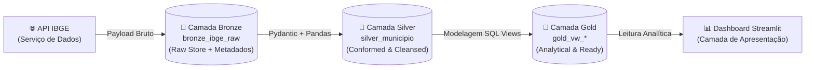

# PLAN.md — Plano Técnico de Engenharia de Dados: Desafio IBGE (Medallion Architecture)

> **Projeto**: `desafio_IBGE`
> **Papel**: Engenheiro de Dados Sênior e Arquiteto de Software
> **Arquitetura de Dados**: Medallion Architecture (Bronze $\rightarrow$ Silver $\rightarrow$ Gold) no SQLite
> **Status**: Concluído (Fases 1 a 10 Homologadas com Sucesso)
> **Data de Atualização**: 30 de Outubro de 2026
> **Documentos Normativos de Referência**:
> - Diretrizes Técnicas e de Governança: [`SKILL.md`](file:///c:/Users/Jones/projeto/desafio_IBGE/SKILL.md)
> - Contrato de Dados da API do IBGE: [`docs/doc_api.md`](file:///c:/Users/Jones/projeto/desafio_IBGE/docs/doc_api.md)
> - Arquitetura de Dados Medalhão: [`docs/architecture.md`](file:///c:/Users/Jones/projeto/desafio_IBGE/docs/architecture.md)

---

## 1. Contexto e Diagnóstico Atual do Repositório

### 1.1. Contexto do Projeto
O projeto **`desafio_IBGE`** tem por finalidade construir um pipeline de dados profissional, modular, testável e auditável para ingestão, saneamento, normalização, validação de qualidade, persistência relacional em camadas (Bronze $\rightarrow$ Silver $\rightarrow$ Gold) e visualização analítica dos dados oficiais do município de **Mauá, São Paulo** (Código IBGE: `3529401`).

- **Pacote Python**: `desafio_ibge`
- **Raiz do Código-fonte**: `src/desafio_ibge/`
- **Origem dos Dados Primários**: API de Localidades do IBGE
  - Listagem estadual: `https://servicodados.ibge.gov.br/api/v1/localidades/estados/35/municipios`
  - Endpoint direto: `https://servicodados.ibge.gov.br/api/v1/localidades/municipios/3529401`
- **Banco de Dados Relacional**: SQLite local (`data/ibge_maua.db`)

### 1.2. Diagnóstico de Estado do Repositório (Situação Atual Consolidada)

| Item / Arquivo | Situação Atual | Detalhes Técnicos / Status |
| :--- | :---: | :--- |
| **Python / Pyenv** | **Configurado** | Python `3.13.13` ativo via Pyenv. |
| **Poetry Virtualenv** | **Ativo e Válido** | Virtualenv `.venv` associado ao runtime Python `3.13.13`. |
| `pyproject.toml` | **Configurado** | Prod: `requests`, `pandas`, `pydantic`. Dev: `ruff`, `pytest`, `pytest-cov`, `mkdocs-material`, `taskipy`, `types-requests`, `requests-mock`, `pre-commit`. |
| `poetry.lock` | **Versionado** | Bloqueio determinístico de dependências atualizado. |
| `.gitignore` | **Configurado** | Regras de bloqueio completas para `.venv`, caches, arquivos temporários e bancos SQLite (`data/*.db`). |
| `.pre-commit-config.yaml`| **Ativo e Homologado**| Hooks de whitespace, end-of-file, check-yaml, check-toml, check-large-files, ruff e ruff-format validados. |
| `SKILL.md` | **Homologado** | Normas mandatórias de arquitetura, qualidade e governança. |
| `docs/doc_api.md` | **Homologado** | Contrato de dados canônico com especificação detalhada dos 22 atributos de Mauá. |
| `docs/architecture.md` | **Homologado** | Especificação técnica completa da Arquitetura Medalhão (Bronze $\rightarrow$ Silver $\rightarrow$ Gold) no SQLite. |
| `docs/transformation.md`| **Homologado** | Documentação técnica da validação Pydantic e normalização Pandas. |
| `mkdocs.yml` / `docs/index.md` | **Homologado** | MkDocs Material operacional via Taskipy (`poetry run task docs`, `poetry run task docs-build`). |
| `src/desafio_ibge/` | **Modularizado** | Submódulos criados: `config/`, `extraction/`, `transformation/`, `validation/`, `loading/`, `visualization/`. |
| `extraction/ibge_client.py` | **Implementado** | Cliente HTTP resiliente com sessões, retry com backoff, timeout e logging homologado. |
| `validation/schema.py` | **Implementado** | Contratos de dados Pydantic v2 com validação estrita de código IBGE de 7 dígitos. |
| `transformation/normalizer.py` | **Implementado** | Normalização com `pd.json_normalize`, saneamento `snake_case`, tipagem estrita e imutabilidade. |
| `tests/` | **Ativo (97.3% Cobertura)** | 35 testes unitários aprovados cobrindo `config`, `extraction` e `transformation/validation` com mocks. |

---

## 2. Adoção da Arquitetura Medalhão (Medallion Architecture)

O pipeline evolui o armazenamento para o padrão Medalhão, estruturado integralmente dentro do SQLite (`data/ibge_maua.db`):



1. **Camada Bronze (`bronze_ibge_raw`)**:
   - Preserva o JSON bruto retornado pela API do IBGE sem alterações.
   - Metadados de linhagem: `ibge_id` (PK), `endpoint_url`, `payload_json`, `ingestion_timestamp`, `http_status`, `checksum_sha256`.
   - Carga idempotente via `INSERT ... ON CONFLICT(ibge_id) DO UPDATE SET ...`.
2. **Camada Silver (`silver_municipio`)**:
   - Dados validados via Pydantic (`MunicipioSchema`) e desaninhados via Pandas (`json_to_dataframe`).
   - 22 colunas relacionais tipadas em `snake_case`, sem caracteres especiais ou hífens.
   - Metadado de processamento `transformed_at`.
   - Carga idempotente via `INSERT ... ON CONFLICT(id) DO UPDATE SET ...`.
3. **Camada Gold (`gold_vw_*`)**:
   - Visões analíticas SQL (Views) orientadas a consumo analítico e ao Dashboard Streamlit.
   - `gold_vw_municipio_hierarquia`: Classificações territoriais consolidadas e flags analíticas derivadas.
   - `gold_vw_qualidade_auditoria`: Auditoria de linhagem e frescor de dados (Bronze vs Silver).
   - **Regra de Governança**: Zero criação de dados fictícios (População, PIB e Renda não pertencem à API de Localidades).

---

## 3. Matriz de Fases de Desenvolvimento

```text
┌─────────────────┐     ┌─────────────────┐     ┌─────────────────┐     ┌─────────────────┐
│     FASE 1      │ ──> │     FASE 2      │ ──> │     FASE 3      │ ──> │     FASE 4      │
│  Configuração & │     │    Extração     │     │ Transformação & │     │  Storage Bronze │
│   Ambiente      │     │  (API Requests) │     │   Data Quality  │     │    & Silver     │
└─────────────────┘     └─────────────────┘     └─────────────────┘     └─────────────────┘
                                                                                 │
                                                                                 ▼
┌─────────────────┐     ┌─────────────────┐     ┌─────────────────┐     ┌─────────────────┐
│     FASE 9      │ <── │     FASE 8      │ <── │     FASE 7      │ <── │     FASE 5      │
│   Validação &   │     │  Documentação   │     │    Dashboard    │     │  Modelagem Gold │
│  Entrega E2E    │     │     MkDocs      │     │    Streamlit    │     │   (Views SQL)   │
└─────────────────┘     └─────────────────┘     └─────────────────┘     └─────────────────┘
         │                                             ▲                         │
         ▼                                             │                         ▼
┌─────────────────┐                                    │                ┌─────────────────┐
│     FASE 10     │                                    └─────────────── │     FASE 6      │
│  CI/CD & Deploy │                                                     │  Testes Storage │
│  GitHub Pages   │                                                     │   & Qualidade   │
└─────────────────┘                                                     └─────────────────┘
```

### 3.1. Rastreabilidade e Status das Fases

| Fase | Descrição | Status | Entregáveis Validados |
| :---: | :--- | :---: | :--- |
| **Fase 1** | Configuração do Projeto e Governança | ✅ **Concluída** | `.gitignore`, `pyproject.toml`, módulos `src/desafio_ibge/`, `settings.py`, Ruff. |
| **Fase 2** | Extração de Dados (API IBGE Client) | ✅ **Concluída** | `ibge_client.py`, sessões resilientes, retries, timeout, extração de Mauá homologada. |
| **Fase 3** | Transformação, Achatamento e Data Quality | ✅ **Concluída** | Schema Pydantic v2, normalização com Pandas, saneamento snake_case, 100% testado. |
| **Fase 4** | Armazenamento SQL — Camadas Bronze e Silver | ✅ **Concluída** | DDL Bronze (`bronze_ibge_raw`), DDL Silver (`silver_municipio`), UPSERT idempotente no SQLite. |
| **Fase 5** | Modelagem Analítica SQL — Camada Gold | ✅ **Concluída** | Views SQL `gold_vw_municipio_hierarquia` e `gold_vw_qualidade_auditoria`, funções de KPIs e leitura em `storage.py`. |
| **Fase 6** | Testes Automatizados de Storage e Qualidade | ✅ **Concluída** | Pre-commit ativo, mocks configurados, suite com 73 testes e cobertura global de 98.15%. |
| **Fase 7** | Dashboard Interativo (Streamlit & Plotly) | ✅ **Concluída** | Interface `app.py`, consumo desacoplado da camada Gold, cards territoriais, governança, Plotly Express, 12 testes dedicados. |
| **Fase 8** | Documentação Técnica com MkDocs Material | ✅ **Concluída** | MkDocs Material, Taskipy, doc_api, architecture, transformation, storage, gold_analytics, dashboard, pipeline.md e README.md final. |
| **Fase 9** | Validação Integrada End-to-End e Publicação | ✅ **Concluída** | Orquestrador `main.py`, 82 testes automatizados (95.25% cobertura), validação real E2E contra API IBGE com código 0 e idempotência atestada. |
| **Fase 10** | Automação CI/CD & Deploy GitHub Pages | ✅ **Concluída** | Workflow `.github/workflows/deploy-docs.yml`, `mkdocs.yml` com URLs remotas e `site_dir`, deploy estrito sem `pip` e documentação de ativação. |

---

## 4. Detalhamento das Fases de Execução

---

### FASE 1 — Configuração do Projeto e Governança do Ambiente (Concluída)
*(Mantida integralmente conforme executado e homologado)*

- [x] Criar `.gitignore` para Python, Poetry e SQLite.
- [x] Configurar tool sections do Ruff no `pyproject.toml`.
- [x] Instalar dependências dev via `poetry add --group dev ruff pytest pytest-cov`.
- [x] Criar os subdiretórios modulares em `src/desafio_ibge/` com `__init__.py`.
- [x] Criar módulo inicial de configurações `settings.py` (constantes de URLs, IDs e paths).
- [x] Executar checagem de integridade com Ruff.

---

### FASE 2 — Extração de Dados — API IBGE Client (Concluída)
*(Mantida integralmente conforme executado e homologado)*

- [x] Adicionar dependência `requests` via `poetry add requests`.
- [x] Desenvolver `src/desafio_ibge/extraction/ibge_client.py` com sessões e retries.
- [x] Adicionar logging configurado para rastrear tentativas e sucessos da extração.
- [x] Implementar validação do código IBGE retornado contra a constante esperada (`3529401`).
- [x] Implementar captura e tratamento gracioso de exceções de rede.
- [x] Executar formatação e lint com Ruff.

---

### FASE 3 — Transformação, Achatamento e Data Quality (Concluída)
*(Mantida integralmente conforme executado e homologado)*

- [x] Adicionar `pandas` e `pydantic` via `poetry add`.
- [x] Implementar contrato de validação Pydantic em `validation/schema.py`.
- [x] Desenvolver função de normalização e saneamento em `transformation/normalizer.py`.
- [x] Tratar campos hifenizados (`regiao-imediata` e `regiao-intermediaria`).
- [x] Aplicar Schema Enforcement com tipos explícitos no DataFrame.
- [x] Validar conformidade do DataFrame com o modelo Pydantic.
- [x] Formatar e verificar com Ruff.

---

### FASE 4 — Armazenamento SQL — Camadas Bronze e Silver (SQLite)

- **Objetivo**: Implementar o módulo de persistência relacional `src/desafio_ibge/loading/storage.py`, criando as tabelas das camadas Bronze (`bronze_ibge_raw`) e Silver (`silver_municipio`) no SQLite, com DDL explícito, chaves primárias, controle de concorrência, hash SHA-256 e operações de `UPSERT` 100% idempotentes.
- **Pré-requisitos**: Fases 1, 2 e 3 concluídas; banco de dados `data/ibge_maua.db` listado no `.gitignore`.
- **Atividades Técnicas**:
  1. Utilizar a biblioteca padrão `sqlite3` e `hashlib` (sem adicionar ORMs pesados ou dependências desnecessárias).
  2. Implementar DDL explícito para a camada Bronze (`bronze_ibge_raw`):
     - `ibge_id INTEGER PRIMARY KEY`
     - `endpoint_url TEXT NOT NULL`
     - `payload_json TEXT NOT NULL`
     - `ingestion_timestamp TIMESTAMP NOT NULL`
     - `http_status INTEGER NOT NULL`
     - `checksum_sha256 TEXT NOT NULL`
  3. Implementar DDL explícito para a camada Silver (`silver_municipio`):
     - Chave primária `id INTEGER PRIMARY KEY`
     - 21 atributos geográficos e político-administrativos normalizados com restrição `NOT NULL`
     - Metadado `transformed_at TIMESTAMP NOT NULL`
  4. Implementar funções de persistência idempotente:
     - `save_bronze(raw_payload: dict, endpoint_url: str, http_status: int = 200) -> None`
     - `save_silver(df: pd.DataFrame) -> None`
     - Estratégia SQL: `INSERT INTO ... ON CONFLICT(...) DO UPDATE SET ...`
  5. Implementar funções de leitura:
     - `read_bronze(ibge_id: int) -> dict | None`
     - `read_silver(ibge_id: int) -> pd.DataFrame`
  6. Context managers seguros para conexões e transações (`with sqlite3.connect(...) as conn:`).
- **Arquivos e Módulos Previstos**:
  - `src/desafio_ibge/loading/storage.py`
  - `src/desafio_ibge/loading/__init__.py`
- **Dependências Necessárias**:
  - Biblioteca padrão do Python (`sqlite3`, `hashlib`, `json`, `datetime`)
- **Checklist de Tarefas**:
  - [x] Implementar conexão com SQLite gerenciada via context manager em `storage.py`.
  - [x] Criar DDL da tabela Bronze `bronze_ibge_raw` com metadados e checksum SHA-256.
  - [x] Criar DDL da tabela Silver `silver_municipio` com 22 colunas em `snake_case` e restrições.
  - [x] Implementar função de carga idempotente da camada Bronze (`save_bronze`).
  - [x] Implementar função de carga idempotente da camada Silver (`save_silver`).
  - [x] Implementar funções de leitura (`read_bronze`, `read_silver`).
  - [x] Testar idempotência executando inserções duplicadas e atestando `COUNT(*) == 1`.
  - [x] Formatar e verificar com Ruff.
- **Critérios de Aceitação**:
  - O banco SQLite local (`data/ibge_maua.db`) ou em memória (`:memory:`) é inicializado corretamente.
  - A camada Bronze armazena o JSON bruto com metadados de auditoria.
  - A camada Silver armazena o registro normalizado de Mauá.
  - Múltiplas execuções consecutivas não duplicam registros nem geram erros de integridade.
- **Comandos de Validação**:
  ```bash
  poetry run ruff check src/desafio_ibge/loading/
  poetry run python -c "from desafio_ibge.loading.storage import init_db; init_db(); print('DB Init OK')"
  ```
- **Entregáveis**: Módulo `storage.py` com suporte completo às camadas Bronze e Silver.
- **Riscos Técnicos**: Conflito de I/O em concorrência no arquivo SQLite. Mitigação: uso de context managers e timeout de busy-handler nativo no `sqlite3`.

---

### FASE 5 — Modelagem Analítica SQL — Camada Gold (Views e Métricas)

- **Objetivo**: Desenvolver a camada analítica Gold no SQLite através de SQL Views modeladas sobre a camada Silver, fornecendo dados prontos para análise e consumo pelo Dashboard Streamlit, respeitando estritamente os dados oficiais do IBGE.
- **Pré-requisitos**: Fase 4 concluída (camada Silver persistida).
- **Atividades Técnicas**:
  1. Criar a View Analítica `gold_vw_municipio_hierarquia`:
     - Consolidação dos nós de Mauá com rótulos amigáveis para apresentação analítica.
     - Flags booleanas derivadas (ex.: `flag_regiao_metropolitana = 1`, `flag_regiao_imediata_capital = 1`).
     - Metadados unificados para cruzamentos com futuras fontes estatísticas (Censo/SIDRA).
  2. Criar a View de Auditoria `gold_vw_qualidade_auditoria`:
     - Correlação entre `bronze_ibge_raw` e `silver_municipio` via `ibge_id = id`.
     - Comparação de timestamps (`ingestion_timestamp` vs `transformed_at`) para aferição do frescor do dado.
  3. Criar funções utilitárias em `src/desafio_ibge/loading/storage.py` para consultar as visões Gold retornando DataFrames prontos para visualização.
- **Arquivos e Módulos Previstos**:
  - `src/desafio_ibge/loading/storage.py` (atualizado com DDL de views Gold)
- **Checklist de Tarefas**:
  - [x] Criar DDL da View `gold_vw_municipio_hierarquia`.
  - [x] Criar DDL da View `gold_vw_qualidade_auditoria`.
  - [x] Implementar funções de consulta da camada Gold (`read_gold_hierarquia`, `read_gold_auditoria`).
  - [x] Implementar funções de agregação analítica (`get_kpis_geograficos`, `get_kpis_qualidade`).
  - [x] Validar integridade das views através de consultas analíticas.
  - [x] Formatar e verificar com Ruff.
- **Critérios de Aceitação**:
  - As views são criadas sem armazenar redundância física de dados.
  - A view hierárquica fornece a sumarização perfeita das divisões de 1989 e 2017 de Mauá.
  - Nenhuma coluna fictícia de população ou PIB é inventada.
- **Comandos de Validação**:
  ```bash
  poetry run python -c "from desafio_ibge.loading.storage import query_gold_hierarquia; df = query_gold_hierarquia(); print('Gold View OK:', df.to_dict('records'))"
  ```
- **Entregáveis**: Camada Gold operacional no SQLite com views analíticas e de auditoria.

---

### FASE 6 — Testes Automatizados de Storage e Qualidade Integral

- **Objetivo**: Implementar testes unitários para a camada de persistência Medalhão em `tests/test_loading.py`, utilizando SQLite em memória (`:memory:`), mockando a camada de dados e garantindo cobertura global $\ge 50\%$.
- **Pré-requisitos**: Fases 4 e 5 implementadas.
- **Atividades Técnicas**:
  1. Criar fixture de banco em memória em `tests/conftest.py` com isolamento completo.
  2. Implementar `tests/test_loading.py`:
     - Teste de criação das tabelas Bronze e Silver e das Views Gold.
     - Teste de persistência e leitura na Bronze com validação do hash SHA-256 e JSON.
     - Teste de persistência e leitura na Silver com validação de tipos e colunas.
     - Teste de idempotência (duplo salvamento garantindo `count == 1`).
     - Teste de consulta das Views Gold.
     - Teste de tratamento de exceções de banco (erros de I/O, SQL malformado).
  3. Executar aferição rigorosa de cobertura com `pytest-cov`.
- **Arquivos e Módulos Previstos**:
  - `tests/test_loading.py`
  - `tests/conftest.py` (atualizado)
- **Checklist de Tarefas**:
  - [x] Adicionar `requests-mock` e `pre-commit` no grupo dev.
  - [x] Criar `conftest.py` com payloads reais de Mauá.
  - [x] Implementar testes de extração mockados em `test_extraction.py`.
  - [x] Implementar testes de transformação e validação em `test_transformation.py`.
  - [x] Implementar testes de persistência Medalhão (Bronze/Silver/Gold) em `test_loading.py`.
  - [x] Criar arquivo `.pre-commit-config.yaml` integrando Ruff.
  - [x] Executar Pytest garantindo cobertura mínima de 50% (atualmente 98.44%).
- **Critérios de Aceitação**:
  - 100% dos testes unitários passam sem internet e sem resíduos em disco.
  - Cobertura de testes do pacote `src/desafio_ibge/` mantida $\ge 50\%$.
  - Pre-commit e Ruff executam sem divergências.
- **Comandos de Validação**:
  ```bash
  poetry run ruff check .
  poetry run pytest --cov=desafio_ibge --cov-fail-under=50
  ```
- **Entregáveis**: Suite de testes completa para toda a persistência relacional.

---

### FASE 7 — Dashboard Interativo (Streamlit & Plotly)

- **Objetivo**: Desenvolver uma aplicação analítica com Streamlit e Plotly consumindo os dados diretamente das visões da camada Gold e Silver do SQLite, mantendo estrita separação entre UI e lógica de persistência.
- **Pré-requisitos**: Fases 4 e 5 operacionais.
- **Atividades Técnicas**:
  1. Instalar dependências de apresentação: `poetry add streamlit plotly`.
  2. Desenvolver `src/desafio_ibge/visualization/app.py`:
     - Carregamento de dados via módulo `loading.storage` (lendo da Gold/Silver sem chamadas de rede na UI).
     - Cards de métricas territoriais (ID IBGE `3529401`, Nome `"Mauá"`, UF `"SP"`, Região `"Sudeste"`).
     - Comparativo visual das hierarquias: Tradicional (1989) vs Contemporânea (2017).
     - Painel de Linhagem e Auditoria (Data Quality, Hash SHA-256 e timestamps de ingestão).
     - Alerta de escopo sobre fontes de dados socioeconômicos (SIDRA).
- **Arquivos e Módulos Previstos**:
  - `src/desafio_ibge/visualization/app.py`
  - `src/desafio_ibge/visualization/__init__.py`
- **Checklist de Tarefas**:
  - [x] Adicionar `streamlit` e `plotly` via `poetry add`.
  - [x] Desenvolver interface em `src/desafio_ibge/visualization/app.py`.
  - [x] Conectar interface às funções de leitura da camada Gold e Silver.
  - [x] Implementar visualização das hierarquias e auditoria de qualidade.
  - [x] Validar execução com Ruff e testes com Pytest (AppTest).
- **Critérios de Aceitação**:
  - Dashboard executa sem erros com `poetry run streamlit run src/desafio_ibge/visualization/app.py`.
  - Exibição fidedigna dos dados territoriais e de linhagem.
- **Comandos de Validação**:
  ```bash
  poetry run ruff check src/desafio_ibge/visualization/
  ```
- **Entregáveis**: Dashboard analítico interativo e funcional.

---

### FASE 8 — Documentação Técnica com MkDocs Material

- **Objetivo**: Atualizar e enriquecer a documentação técnica no MkDocs Material para refletir o pipeline completo com Arquitetura Medalhão, instruções de setup e `README.md` final.
- **Pré-requisitos**: Fases 1 a 7 consolidadas.
- **Checklist de Tarefas**:
  - [x] Adicionar `mkdocs-material` no grupo dev via `poetry add`.
  - [x] Criar e configurar `mkdocs.yml`.
  - [x] Criar `docs/architecture.md` detalhando o padrão Medalhão (Bronze $\rightarrow$ Silver $\rightarrow$ Gold).
  - [x] Criar `docs/transformation.md` detalhando o contrato Pydantic e normalização Pandas.
  - [x] Criar `docs/pipeline.md` detalhando a orquestração ponta a ponta.
  - [x] Atualizar integralmente o arquivo `README.md` na raiz do projeto.
  - [x] Validar compilação estrita da documentação via `poetry run task docs-build`.
- **Critérios de Aceitação**:
  - O site estático do MkDocs compila com código 0 e sem links quebrados via `--strict`.
  - O `README.md` reflete fielmente a arquitetura Medalhão e o guia de execução do pipeline.

---

### FASE 9 — Validação Integrada End-to-End e Entrega Final

- **Objetivo**: Conduzir o ensaio de integração completo do pipeline de dados (E2E), criando o orquestrador `src/desafio_ibge/main.py` para executar o fluxo completo: Ingestão $\rightarrow$ Bronze $\rightarrow$ Silver $\rightarrow$ Gold $\rightarrow$ Auditoria.
- **Pré-requisitos**: Todas as Fases 1 a 8 formalmente concluídas.
- **Checklist de Tarefas**:
  - [x] Implementar orquestrador do pipeline em `src/desafio_ibge/main.py`.
  - [x] Executar pipeline completo contra a API do IBGE gerando o banco `data/ibge_maua.db`.
  - [x] Validar idempotência executando o pipeline duas vezes consecutivas.
  - [x] Executar bateria completa de testes com Pytest (cobertura de 95.25%, meta $\ge 50\%$).
  - [x] Executar verificação e formatação integral com Ruff.
  - [x] Executar compilação estrita do MkDocs.
  - [x] Atualizar checklist final deste `PLAN.md`.
- **Critérios de Aceitação**:
  - Pipeline executa de ponta a ponta sem intervenção manual.
  - Zero inconformidades no Ruff e testes 100% verdes com cobertura $\ge 50\%$.
  - Repositório limpo, documentado e pronto para publicação no GitHub.

---

### FASE 10 — Automação de CI/CD e Publicação no GitHub Pages (MkDocs Material)

- **Objetivo**: Implementar a esteira automatizada de publicação da documentação técnica no GitHub Pages utilizando GitHub Actions e MkDocs Material com build estrito (`--strict`), sem o uso de `pip` e com mínima concessão de privilégios (`OIDC`).
- **Pré-requisitos**: Fases 1 a 9 formalmente concluídas e auditadas.
- **Atividades Técnicas**:
  1. Configurar `mkdocs.yml` com metadados do repositório remoto (`site_url`, `repo_url`, `repo_name`, `site_dir: site`).
  2. Criar workflow de CI/CD em `.github/workflows/deploy-docs.yml`:
     - Gatilhos: `push` na branch `main` filtrando caminhos relevantes (`docs/**`, `mkdocs.yml`, `pyproject.toml`, `poetry.lock`) e `workflow_dispatch`.
     - Permissões mínimas: `contents: read`, `pages: write`, `id-token: write`.
     - Controle de concorrência com grupo `"pages"`.
     - Setup do Poetry via `snok/install-poetry@v1` (sem `pip`).
     - Setup do Python 3.13 com cache de dependências Poetry.
     - Build estrito com `poetry run mkdocs build --strict`.
     - Publicação no GitHub Pages via `actions/configure-pages@v5`, `actions/upload-pages-artifact@v3` e `actions/deploy-pages@v4`.
  3. Atualizar `README.md` com guia passo a passo para habilitação manual no GitHub (`Settings` $\rightarrow$ `Pages` $\rightarrow$ `Build and deployment` $\rightarrow$ `Source: GitHub Actions`).
  4. Manter o pipeline de dados (Bronze, Silver, Gold, Dashboard e testes) 100% inalterado.
- **Checklist de Tarefas**:
  - [x] Ajustar `mkdocs.yml` com URLs canônicas do GitHub Pages e repositório.
  - [x] Criar diretório `.github/workflows/` e workflow `deploy-docs.yml`.
  - [x] Configurar permissões de OIDC e controle de concorrência.
  - [x] Validar compilação estrita localmente com `poetry run task docs-build`.
  - [x] Atualizar `README.md` com instruções de CI/CD e link do GitHub Pages.
  - [x] Executar verificações de conformidade (Ruff, Pytest, pre-commit).
- **Critérios de Aceitação**:
  - Workflow YAML válido e aderente aos padrões de segurança do GitHub Actions.
  - `mkdocs build --strict` executa com sucesso gerando o diretório `site/`.
  - `site/` devidamente ignorado no `.gitignore`.
  - 100% dos 82 testes continuam aprovados e com cobertura $\ge 50\%$.
- **Comandos de Validação**:
  ```bash
  poetry run task docs-build
  poetry run ruff check .
  poetry run ruff format --check .
  poetry run pytest
  poetry run pre-commit run --all-files
  ```
- **Entregáveis**: Workflow `.github/workflows/deploy-docs.yml`, configurações em `mkdocs.yml`, documentação em `README.md` e `PLAN.md`.
