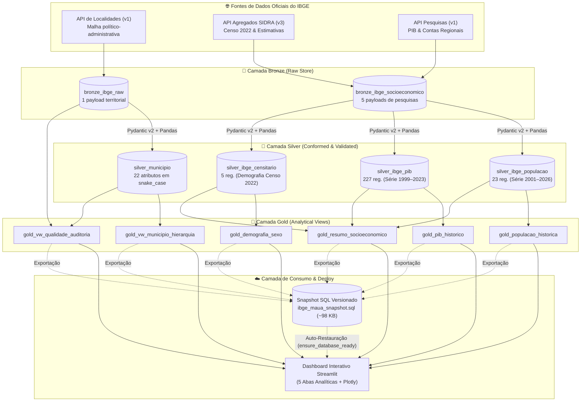

# Desafio IBGE — Engenharia de Dados (Mauá - SP)

[](https://www.python.org/)
[](https://python-poetry.org/)
[](https://github.com/astral-sh/ruff)
[]()
[](https://jonesbastos.github.io/IBGE_MAUA/)
[](https://ibge-maua-dashboard.streamlit.app/)
[](https://opensource.org/licenses/MIT)

Pipeline profissional de Engenharia de Dados para extração, validação, modelagem analítica e visualização de indicadores territoriais e socioeconômicos do município de **Mauá (SP)** (Código IBGE: `3529401`).

O ecossistema implementa o padrão **Medallion Architecture (Bronze, Silver e Gold)** sobre banco relacional **SQLite**, validação de contratos de dados com **Pydantic v2**, normalização tabular de séries históricas com **Pandas**, views analíticas em **SQL** e um dashboard interativo desenvolvido em **Streamlit** e **Plotly Express**, publicado em produção no **Streamlit Community Cloud** com restauração automática via snapshot SQL.

---

## 🔗 Acessos Rápidos

| Recurso | Descrição | Link de Acesso |
| :--- | :--- | :--- |
| 📊 **Dashboard em Produção** | Painel analítico interativo no Streamlit Community Cloud | [ibge-maua-dashboard.streamlit.app](https://ibge-maua-dashboard.streamlit.app/) |
| 📚 **Documentação Técnica** | Site estático completo publicado via GitHub Pages e MkDocs | [jonesbastos.github.io/IBGE_MAUA](https://jonesbastos.github.io/IBGE_MAUA/) |
| 💼 **Apresentação Técnica** | Artigo completo e post de portfólio para LinkedIn | [docs/portfolio_linkedin.md](docs/portfolio_linkedin.md) |
| 🐙 **Repositório GitHub** | Código-fonte versionado com esteira de CI/CD | [github.com/Jonesbastos/IBGE_MAUA](https://github.com/Jonesbastos/IBGE_MAUA) |

---

## 🎯 Problema de Negócio e Motivação Técnica

Os dados públicos disponibilizados pelo **Instituto Brasileiro de Geografia e Estatística (IBGE)** são essenciais para tomada de decisão pública, planejamento urbano, pesquisas acadêmicas e inteligência de mercado. Contudo, o consumo analítico dessas informações enfrenta desafios severos:

1. **Heterogeneidade de Endpoints e Protocolos**: Diferentes pesquisas residem em APIs distintas (Localidades v1, SIDRA Agregados v3, Pesquisas v1), com estruturas de resposta, nomenclaturas de variáveis e granularidades temporais díspares.
2. **Defasagens e Descontinuidades Metodológicas**: Séries econômicas (PIB) possuem defasagem de 2 anos, enquanto operações censitárias ocorrem em intervalos decenais com metodologias de amostragem distintas das estimativas anuais de população.
3. **Fragilidade de Schema (Data Drift)**: Variações silenciosas de tipos ou campos nulos em APIs REST externas podem quebrar relatórios downstream sem detecção prévia.
4. **Custo e Complexidade de Deploy**: Pipelines analíticos para dados abertos com frequência dependem de clusters pesados e bancos gerenciados caros em nuvem para tarefas que podem ser resolvidas com eficiência via arquitetura enxuta e reprodutível.

### Solução Proposta

O projeto **`desafio_IBGE`** resolve esses desafios estruturando um pipeline completo de Engenharia de Dados que consome exclusivamente APIs oficiais, isola cargas brutas em camada Bronze com carimbos e hashes de auditoria, impõe contratos estritos com **Pydantic v2**, padroniza séries temporais na camada Silver com **Pandas**, modela views analíticas na camada Gold com **SQLite/SQL** e serve um dashboard dinâmico em **Streamlit** com inicialização instantânea baseada em snapshots versionados.

---

## 🏛️ Arquitetura da Solução (Medallion Architecture)

A solução organiza a jornada dos dados em três camadas bem delineadas:



### Inventário Físico do Banco SQLite (`data/ibge_maua.db`)

| Camada | Objeto | Tipo | Finalidade / Granularidade | Registros Reais |
| :--- | :--- | :--- | :--- | :---: |
| **Bronze** | `bronze_ibge_raw` | Tabela | Armazenamento do JSON territorial bruto com hash SHA-256 e timestamp UTC | 1 |
| **Bronze** | `bronze_ibge_socioeconomico` | Tabela | Payloads brutos de agregados e pesquisas com identificador de pesquisa | 5 |
| **Silver** | `silver_municipio` | Tabela | 22 atributos territoriais normalizados e validados com Pydantic v2 | 1 |
| **Silver** | `silver_ibge_populacao` | Tabela | Séries temporais de contagens censitárias e estimativas (2001–2026) | 23 |
| **Silver** | `silver_ibge_pib` | Tabela | Rubricas econômicas do PIB municipal em formato tabular long (1999–2023) | 227 |
| **Silver** | `silver_ibge_censitario` | Tabela | Variáveis demográficas do Censo 2022 (sexo, alfabetização, área, densidade) | 5 |
| **Gold** | `gold_vw_municipio_hierarquia` | View | Consolidação da malha territorial (divisões regionais de 1989 e 2017) | 1 |
| **Gold** | `gold_vw_qualidade_auditoria` | View | Auditoria de conciliação Bronze vs Silver, integridade e latência de ingestão | 1 |
| **Gold** | `gold_populacao_historica` | View | Evolução anual de população com janelamento `LAG()` de variação e crescimento | 23 |
| **Gold** | `gold_pib_historico` | View | Série econômica com cálculo seguro de participações setoriais (`NULLIF`) | 25 |
| **Gold** | `gold_demografia_sexo` | View | Totalização por gênero, participações relativas e razão de sexo (H/100 M) | 1 |
| **Gold** | `gold_resumo_socioeconomico` | View | Síntese executiva dos principais KPIs consolidados mais recentes | 9 |
| **Total** | **6 Tabelas + 6 Views** | — | **Banco Relacional Autocontido e Totalmente Idempotente** | **322 registros** |

---

## 🛠️ Tecnologias Utilizadas

| Tecnologia | Categoria | Justificativa Técnica |
| :--- | :--- | :--- |
| **Python 3.13** | Linguagem Principal | Desempenho aprimorado, tipagem moderna e suporte a ecossistemas recentes. |
| **Poetry** | Dependency Manager | Resolução determinística via lockfile, separação de dependências e empacotamento padrão PEP 517/621. |
| **Requests & Urllib3** | Ingestão HTTP | Pooling de conexões, timeouts explícitos e política de retries exponenciais (`HTTPAdapter`). |
| **Pydantic v2** | Data Quality & Schemas | Validação de tipos em alta performance (Rust core), coerção defensiva e contratos de dados estritos. |
| **Pandas** | Transformação Tabular | Desaninhamento de árvores JSON, manipulação de séries temporais e normalização tabular. |
| **SQLite 3** | Persistência Relacional | Banco embarcado ACID, zero overhead de infraestrutura, transações atômicas e portabilidade total. |
| **Streamlit** | Dashboard Interativo | Interface reativa em Python, integração nativa com Pandas e cacheamento em memória (`@st.cache_data`). |
| **Plotly Express** | Visualização de Dados | Gráficos interativos com tooltips dinâmicos, linhas multivariadas e áreas empilhadas. |
| **Pytest & AppTest** | Testes Automatizados | Testes unitários, testes de integração E2E e validação de interface via `streamlit.testing.v1.AppTest`. |
| **Ruff** | Linter & Formatter | Validação estática e formatação de código ultra-rápida, garantindo conformidade com PEP 8. |
| **Taskipy** | Task Runner | Automação de comandos frequentes de desenvolvimento, testes, compilação de docs e snapshots. |
| **MkDocs Material** | Documentação Técnica | Geração de documentação estática moderna, busca integrada, diagramas Mermaid e build estrito. |
| **GitHub Actions** | CI/CD | Pipeline automatizado de compilação estrita e publicação no GitHub Pages a cada commit. |

---

## 📊 Funcionalidades do Dashboard (5 Abas Analíticas)

O dashboard analítico divide-se em 5 abas temáticas projetadas para visualização executiva e técnica:

1. **Visão Geral Territorial & Socioeconômica**:
   - Cards de indicadores estratégicos: População Censitária (418.261), População Estimada (429.064), PIB Corrente (R$ 25,00 bilhões), PIB per capita (R$ 59.773,04), Área Territorial (61,937 km²), Densidade (6.753,01 hab/km²) e Alfabetização (96,74%).
   - Hierarquia político-administrativa completa de Mauá (Região Metropolitana, Microrregião, Região Imediata e Intermediária).
   - Tabela dinâmica pesquisável com recurso de exportação direta em CSV.
2. **População Histórica**:
   - Gráfico de linhas Plotly comparando as operações do Censo Demográfico com as Estimativas Anuais de População (2001–2026).
   - Slider de recorte temporal interativo com cálculo dinâmico da variação absoluta e crescimento acumulado.
3. **Economia & PIB**:
   - Séries históricas do PIB a preços correntes e do PIB per capita de Mauá (1999–2023).
   - Gráfico de área empilhada percentual detalhando a composição setorial do Valor Adicionado Bruto (Serviços, Indústria, Administração Pública e Agropecuária).
   - Alerta metodológico de governança destacando a defasagem temporal de 2 anos nas Contas Regionais.
4. **Demografia & Alfabetização**:
   - Distribuição populacional por sexo via gráfico de rosca (51,86% feminino vs 48,14% masculino).
   - Exibição da Razão de Sexo oficial (92,82 homens para cada 100 mulheres).
   - Indicadores de educação (taxa de alfabetização de 96,74%) e densidade demográfica urbana.
5. **Governança & Auditoria**:
   - Volumetria total da arquitetura Medalhão com abertura por domínio (322 registros reais).
   - Indicadores de integridade de dados (taxa de conformidade de 100% e ausência de nulos).
   - Métricas de linhagem e latência de execução do pipeline em segundos.
   - Catálogo formal de metadados relacionais com granularidades e chaves primárias.

---

## 📸 Demonstração do Dashboard

Esta seção reúne o mapeamento visual das abas da aplicação interativa. As imagens de referência encontram-se estruturadas no diretório `docs/assets/dashboard/`.

> [!TIP]
> **Como Adicionar/Atualizar as Capturas de Tela**:
> 1. Acesse o dashboard oficial em produção: [https://ibge-maua-dashboard.streamlit.app/](https://ibge-maua-dashboard.streamlit.app/).
> 2. Navegue por cada uma das abas listadas abaixo.
> 3. Realize a captura de tela na resolução recomendada de 1920x1080 (16:9).
> 4. Salve os arquivos PNG com os nomes indicados dentro de `docs/assets/dashboard/`.

| Aba | Arquivo de Destino | Conteúdo Analítico em Destaque |
| :--- | :--- | :--- |
| **1. Visão Geral** | `docs/assets/dashboard/01_visao_geral.png` | Cards de KPIs municipais, hierarquia administrativa e tabela com exportação CSV. |
| **2. População Histórica** | `docs/assets/dashboard/02_evolucao_populacional.png` | Curva comparativa de Censos e Estimativas (2001–2026) com slider temporal interativo. |
| **3. Economia e PIB** | `docs/assets/dashboard/03_economia_pib.png` | Evolução do PIB, curva de PIB per capita e área empilhada do VAB setorial. |
| **4. Demografia e Alfabetização** | `docs/assets/dashboard/04_demografia_alfabetizacao.png` | Gráfico de rosca por sexo, razão de sexo oficial e taxa de alfabetização (96,74%). |
| **5. Governança e Auditoria** | `docs/assets/dashboard/05_governanca_auditoria.png` | Gráfico de volumetria Medallion (322 registros), conformidade (100%) e linhagem. |

---

## 📁 Estrutura de Diretórios do Projeto

```text
desafio_IBGE/
├── .github/                       # Configurações de CI/CD (GitHub Actions)
│   └── workflows/
│       └── deploy-docs.yml        # Pipeline de build estrito e deploy MkDocs no GitHub Pages
├── data/                          # Armazenamento local do SQLite (.gitignore)
│   ├── ibge_maua.db               # Banco de dados local com 322 registros (ignorado pelo Git)
│   └── snapshots/                 # Snapshots SQL versionados para deploy em nuvem
│       └── ibge_maua_snapshot.sql # DDLs + dados de Mauá (SP) (~98 KB em texto puro UTF-8)
├── docs/                          # Documentação técnica completa em MkDocs Material
│   ├── assets/
│   │   └── dashboard/             # Mapeamento de prints das 5 abas analíticas
│   ├── architecture.md            # Especificação profunda da Medallion Architecture
│   ├── dashboard.md               # Detalhamento funcional das 5 abas do Streamlit
│   ├── doc_api.md                 # Dicionário de variáveis e endpoints oficiais do IBGE
│   ├── gold_analytics.md          # Especificação das 6 Views Gold e métricas analíticas
│   ├── index.md                   # Página inicial da documentação técnica
│   ├── pipeline.md                # Orquestração do pipeline E2E, logs e resiliência
│   ├── portfolio_linkedin.md      # Artigo técnico completo e post conciso para LinkedIn
│   ├── storage.md                 # Schemas DDL, UPSERTs e persistência SQLite
│   └── transformation.md          # Contratos Pydantic v2 e normalização Pandas
├── src/
│   └── desafio_ibge/              # Pacote Python principal da aplicação
│       ├── config/                # Constantes de rede, endpoints oficiais e paths
│       ├── extraction/            # Cliente HTTP resiliente com retries e timeouts
│       ├── loading/               # Gerenciador transacional SQLite, DDLs, Views e Snapshots
│       ├── transformation/        # Normalizadores Pandas e desaninhamento tabular
│       ├── validation/            # Contratos de dados estritos com Pydantic v2
│       ├── visualization/         # Dashboard interativo Streamlit com gráficos Plotly
│       └── main.py                # Orquestrador unificado E2E com fail-fast e auditoria
├── tests/                         # Suite automatizada com 152 testes
│   ├── conftest.py                # Fixtures e payloads reais do município de Mauá
│   ├── test_config.py             # Testes de parâmetros e URLs de configuração
│   ├── test_extraction.py         # Testes de cliente HTTP com mocks e tratamento de falhas
│   ├── test_integration.py        # Testes de integração end-to-end do pipeline
│   ├── test_loading.py            # Testes de persistência Bronze, Silver, Gold e Snapshots
│   ├── test_transformation.py     # Testes de validação Pydantic e normalização Pandas
│   └── test_visualization.py      # Testes de interface do Dashboard via Streamlit AppTest
├── .gitignore                     # Exclusão de artefatos temporários, caches e bases locais
├── .pre-commit-config.yaml        # Hooks automatizados de qualidade pré-commit
├── mkdocs.yml                     # Configuração da documentação técnica MkDocs Material
├── pyproject.toml                 # Gerenciamento de dependências, Pytest e atalhos Taskipy
├── PLAN.md                        # Planejamento e histórico técnico de execução das fases
├── README.md                      # Vitrine técnica e documentação principal do repositório
└── SKILL.md                       # Regras arquiteturais e diretrizes de desenvolvimento
```

---

## 🚀 Guia de Execução Local Passo a Passo

### Pré-requisitos
- **Python**: `>=3.13,<4.0` (recomendado: `3.13.13` gerenciado via **Pyenv**)
- **Poetry**: `>=2.0`

### 1. Clonar o Repositório e Configurar o Ambiente
```bash
# Clonar o repositório
git clone https://github.com/Jonesbastos/IBGE_MAUA.git
cd IBGE_MAUA

# Definir a versão local do Python com Pyenv
pyenv local 3.13.13

# Instalar todas as dependências do projeto via Poetry
poetry install
```

### 2. Executar o Pipeline de Dados Completo (E2E)
```bash
poetry run python -m desafio_ibge.main
# ou via atalho Taskipy:
poetry run task pipeline
```
O orquestrador executa o fluxo integrado:
**Ingestão de APIs Oficiais $\rightarrow$ Validação Pydantic v2 $\rightarrow$ Persistência Bronze $\rightarrow$ Normalização Silver $\rightarrow$ Criação das Views Gold $\rightarrow$ Auditoria Integrada**.

### 3. Executar o Dashboard Analítico Localmente
```bash
poetry run streamlit run src/desafio_ibge/visualization/app.py
# ou via atalho Taskipy:
poetry run task dashboard
```
Acesse o painel analítico no navegador em: `http://localhost:8501`.

### 4. Exportar Snapshot SQL Versionado
```bash
poetry run task export-snapshot
```
Gera o arquivo `data/snapshots/ibge_maua_snapshot.sql` (~98 KB) contendo todos os DDLs e os 322 registros consolidados.

### 5. Executar a Suíte de Testes e Garantia de Qualidade
```bash
# Executar a suite completa de 152 testes com relatório de cobertura (>93%)
poetry run task test

# Checagem estática de linter com Ruff
poetry run ruff check .

# Checagem de formatação de código com Ruff
poetry run ruff format --check .

# Execução de todos os hooks do pre-commit
poetry run pre-commit run --all-files
```

### 6. Executar a Documentação Técnica Localmente
```bash
# Iniciar servidor de documentação com live reload
poetry run task docs

# Validar compilação estrita (Strict Build — zero erros e zero warnings)
poetry run task docs-build
```

---

## ☁️ Estratégia de Deploy em Produção (Streamlit Community Cloud)

O dashboard opera em produção no **Streamlit Community Cloud** sob arquitetura stateless, resiliente e de custo zero:

1. **Restauração Automática via Snapshot SQL**:
   Como o arquivo binário local `data/ibge_maua.db` é ignorado pelo Git via `.gitignore`, a função `ensure_database_ready()` em `storage.py` é disparada na inicialização do aplicativo. Ela identifica a ausência do banco e restaura atomicamente todo o esquema relacional (6 tabelas e 6 views com 322 registros) a partir do script `data/snapshots/ibge_maua_snapshot.sql` em menos de **20 milissegundos**.
2. **Zero Chamadas a APIs no Startup**:
   O aplicativo na nuvem não realiza requisições HTTP para as APIs externas do IBGE ao iniciar, evitando gargalos de taxa limite (*rate limit*), instabilidades ou latências de rede.
3. **Gerenciamento Nativo com Poetry**:
   O Streamlit Community Cloud detecta diretamente o `pyproject.toml` e o `poetry.lock`, eliminando a necessidade de arquivos `requirements.txt` secundários.
4. **Sem Credenciais Sensíveis**:
   A aplicação utiliza dados 100% públicos e abertos; nenhuma variável de ambiente secreta é necessária.

- 🌐 **Dashboard Ativo**: [https://ibge-maua-dashboard.streamlit.app/](https://ibge-maua-dashboard.streamlit.app/)

---

## 🧪 Testes Automatizados e Qualidade de Código

A qualidade e a estabilidade do ecossistema são asseguradas por uma suíte completa de testes automatizados com cobertura aferida pelo **pytest-cov**:

- **Total de Testes**: **152 testes aprovados** (100% de sucesso).
- **Cobertura Geral**: **93.44%** de cobertura do pacote `src/desafio_ibge`.
- **Estratégias de Teste**:
  - **Testes Unitários**: Validação de parâmetros de configuração, DDLs e normalizadores Pandas.
  - **Testes de Contratos Pydantic**: Validação de esquemas válidos, coerções de tipos e rejeição de dados corrompidos.
  - **Testes de Integração**: Orquestrador E2E com mocks de API e banco SQLite em memória.
  - **Testes de Interface Streamlit**: Utilização de `streamlit.testing.v1.AppTest` para validar a renderização de abas, fallbacks defensivos e ausência de exceções visuais.
  - **Linter & Formatter**: Conformidade estrita verificada via **Ruff** e hooks do **pre-commit**.

---

## 🌐 Fontes de Dados Oficiais do IBGE

| Serviço de Dados | Endpoint / Documentação Oficial | Variáveis / Domínio Utilizado |
| :--- | :--- | :--- |
| **API de Localidades** | [servicodados.ibge.gov.br/api/v1/localidades](https://servicodados.ibge.gov.br/api/v1/localidades) | Malha territorial, código IBGE `3529401`, mesorregião, microrregião, regiões imediata e intermediária. |
| **API de Agregados (SIDRA v3)** | [servicodados.ibge.gov.br/api/v3/agregados/9514](https://servicodados.ibge.gov.br/api/v3/agregados) | Censo Demográfico 2022: População residente total, distribuição por sexo e taxas de alfabetização. |
| **API de Agregados (SIDRA v3)** | [servicodados.ibge.gov.br/api/v3/agregados/6579](https://servicodados.ibge.gov.br/api/v3/agregados) | Estimativas Anuais de População Residente (Série Histórica 2001 a 2026). |
| **API de Pesquisas** | [servicodados.ibge.gov.br/api/v1/pesquisas/38](https://servicodados.ibge.gov.br/api/v1/pesquisas) | Contas Regionais: PIB a preços correntes, PIB per capita e Valor Adicionado Bruto setorial (1999–2023). |

---

## 🗺️ Próximos Passos e Evolução Técnica

Para os próximos ciclos de desenvolvimento, estão mapeadas as seguintes evoluções de engenharia:

- [ ] **Expansão para a Região do Grande ABC**: Ampliar o pipeline para ingerir e comparar simultaneamente os 7 municípios da região (Santo André, São Bernardo do Campo, São Caetano do Sul, Diadema, Mauá, Ribeirão Pires e Rio Grande da Serra).
- [ ] **Orquestração com Apache Airflow ou Prefect**: Implementar DAGs agendadas para verificar periodicamente a publicação de novas pesquisas pelo IBGE.
- [ ] **Integração com Data Warehouse Cloud**: Configurar conector para replicação das tabelas Silver e Gold em Snowflake, Google BigQuery ou DuckDB.
- [ ] **Monitoramento Contínuo com Great Expectations**: Adicionar suíte formal de *data quality assertions* com alertas automatizados para detecção precoce de *data drift*.

---

## 📄 Licença

Este projeto está distribuído sob a licença **MIT**. Consulte o arquivo [LICENSE](LICENSE) para mais detalhes.

---

**Autor**: Jones Bastos
**LinkedIn**: [linkedin.com/in/jones-bastos](https://www.linkedin.com/in/jones-bastos)
**GitHub**: [github.com/Jonesbastos](https://github.com/Jonesbastos)
