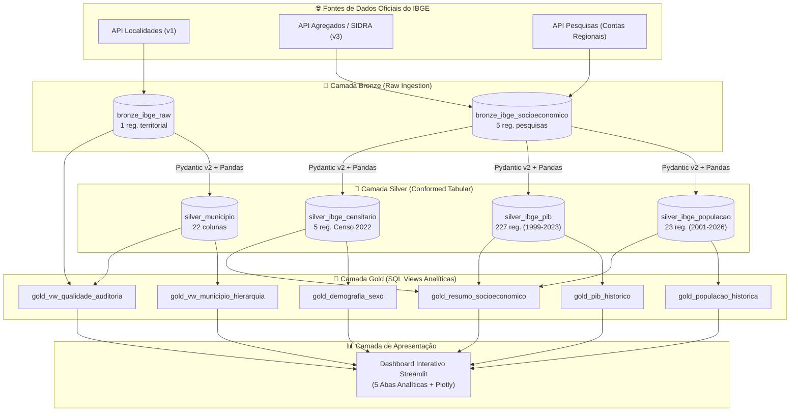

# Desafio IBGE — Engenharia de Dados (Mauá - SP)

[](https://www.python.org/)
[](https://python-poetry.org/)
[](https://github.com/astral-sh/ruff)
[]()
[](https://jonesbastos.github.io/IBGE_MAUA/)
[](https://opensource.org/licenses/MIT)

Pipeline profissional de Engenharia de Dados desenvolvido em Python utilizando dados oficiais do IBGE sobre o município de **Mauá (SP)** (Código IBGE: `3529401`), estruturado sob o padrão **Medallion Architecture (Bronze, Silver e Gold)** no **SQLite**, validação de contratos de dados com **Pydantic v2**, normalização tabular de séries temporais com **Pandas** e dashboard analítico interativo em **Streamlit** e **Plotly Express**.

---

## 1. Visão Geral da Arquitetura Medalhão

O ecossistema implementa o padrão Medalhão com separação estrita de camadas e persistência relacional unificada local em `data/ibge_maua.db`:



### Inventário de Tabelas e Views no SQLite (`data/ibge_maua.db`)

| Camada | Objeto | Tipo | Finalidade / Granularidade | Registros Reais |
| :--- | :--- | :--- | :--- | :---: |
| **Bronze** | `bronze_ibge_raw` | Tabela | Payload JSON territorial bruto + hash SHA-256 | 1 |
| **Bronze** | `bronze_ibge_socioeconomico` | Tabela | Payloads brutos de agregados e pesquisas + SHA-256 | 5 |
| **Silver** | `silver_municipio` | Tabela | 22 atributos territoriais normalizados em `snake_case` | 1 |
| **Silver** | `silver_ibge_populacao` | Tabela | Séries de População Censitária e Estimada (2001–2026) | 23 |
| **Silver** | `silver_ibge_pib` | Tabela | Rubricas de PIB, VABs e impostos em formato long (1999–2023) | 227 |
| **Silver** | `silver_ibge_censitario` | Tabela | Indicadores do Censo 2022 (sexo, alfabetização, área, densidade) | 5 |
| **Gold** | `gold_vw_municipio_hierarquia` | View | Árvore territorial unificada (divisões 1989 e 2017) | 1 |
| **Gold** | `gold_vw_qualidade_auditoria` | View | Auditoria de conciliação Bronze vs Silver e latência | 1 |
| **Gold** | `gold_populacao_historica` | View | Série temporal com LAG de crescimento anual e percentual | 23 |
| **Gold** | `gold_pib_historico` | View | Série econômica com participações do VAB com `NULLIF` | 25 |
| **Gold** | `gold_demografia_sexo` | View | População por sexo, percentuais e Razão de Sexo oficial | 1 |
| **Gold** | `gold_resumo_socioeconomico` | View | Síntese executiva dos indicadores mais recentes apurados | 9 |
| **Total Físico**| **6 Tabelas Relacionais** | — | **Armazenamento com Idempotência Estrita** | **322 registros** |

---

## 2. Estrutura do Repositório

```text
desafio_IBGE/
├── .github/                       # Configurações de CI/CD (GitHub Actions)
│   └── workflows/
│       └── deploy-docs.yml        # Pipeline de build estrito e deploy MkDocs
├── data/                          # Armazenamento local do SQLite (.gitignore)
│   └── ibge_maua.db               # Banco de dados com as 6 tabelas e 6 views
├── docs/                          # Documentação técnica completa em MkDocs
│   ├── architecture.md            # Arquitetura Medalhão detalhada
│   ├── dashboard.md               # Especificação das 5 abas do Dashboard
│   ├── doc_api.md                 # Especificação técnica das APIs do IBGE
│   ├── gold_analytics.md          # Camada Gold, SQL Views e Métricas
│   ├── index.md                   # Página inicial da documentação
│   ├── pipeline.md                # Orquestração do pipeline end-to-end
│   ├── storage.md                 # Schemas DDL, UPSERTs e persistência SQLite
│   └── transformation.md          # Schemas Pydantic v2 e normalização Pandas
├── src/
│   └── desafio_ibge/              # Pacote Python principal
│       ├── config/                # Constantes, URLs oficiais e paths
│       ├── extraction/            # Cliente HTTP com retries e timeouts
│       ├── loading/               # Gerenciador SQLite, DDLs e Views Gold
│       ├── transformation/        # Desaninhamento e saneamento tabular
│       ├── validation/            # Contratos Pydantic v2 de Data Quality
│       ├── visualization/         # Dashboard interativo Streamlit & Plotly
│       └── main.py                # Orquestrador unificado E2E com fail-fast
├── tests/                         # Suite automatizada com 145 testes
│   ├── conftest.py                # Fixtures e payloads reais de Mauá
│   ├── test_config.py             # Testes de configurações
│   ├── test_extraction.py         # Testes de cliente HTTP com mocks
│   ├── test_integration.py        # Testes de integração ponta a ponta
│   ├── test_loading.py            # Testes de persistência Bronze, Silver e Gold
│   ├── test_transformation.py     # Testes de validação e normalização
│   └── test_visualization.py      # Testes do Dashboard com Streamlit AppTest
├── mkdocs.yml                     # Configuração do MkDocs Material
├── pyproject.toml                 # Definição de dependências, Pytest e Taskipy
├── PLAN.md                        # Planejamento técnico por fases e subetapas
├── README.md                      # Apresentação do projeto e guia de uso
└── SKILL.md                       # Regras e padrões de engenharia de dados
```

---

## 3. Guia de Instalação e Execução

### Pré-requisitos
- **Python**: `>=3.13,<4.0` (recomendado: Python `3.13.13` gerenciado via **Pyenv**)
- **Poetry**: `>=2.0`

### 3.1. Configuração do Ambiente Virtual
```bash
# Definir versão do Python no repositório
pyenv local 3.13.13

# Instalar todas as dependências de produção e desenvolvimento
poetry install
```

### 3.2. Executar o Pipeline de Dados Completo (E2E)
```bash
poetry run python -m desafio_ibge.main
# ou via atalho Taskipy:
poetry run task pipeline
```
Esse comando orquestra o fluxo integrado de ponta a ponta:
**Extração Territorial & Socioeconômica $\rightarrow$ Validação Pydantic v2 $\rightarrow$ Carga Bronze $\rightarrow$ Normalização Silver $\rightarrow$ Sincronização das 6 Views Gold $\rightarrow$ Auditoria Integrada**.

### 3.3. Executar o Dashboard Analítico (Streamlit)
```bash
poetry run streamlit run src/desafio_ibge/visualization/app.py
# ou via atalho Taskipy:
poetry run task dashboard
```
Acesse a aplicação interativa no navegador em `http://localhost:8501`.

### 3.4. Executar Validações de Qualidade de Código e Testes
```bash
# Checagem estática com Ruff
poetry run ruff check .

# Formatação automática de código
poetry run ruff format .

# Suite completa de testes automatizados com cobertura (mínimo 50%)
poetry run task test
```

### 3.5. Documentação Técnica e Publicação Contínua (GitHub Pages)

#### Visualização e Compilação Local (Taskipy)
```bash
# Iniciar servidor local de documentação com live reload
poetry run task docs

# Validar compilação estrita (Strict Build — sem links quebrados ou warnings)
poetry run task docs-build
```

#### Publicação Automatizada via GitHub Actions
O projeto conta com uma esteira de CI/CD em [`.github/workflows/deploy-docs.yml`](.github/workflows/deploy-docs.yml) que compila em modo estrito e publica a documentação automaticamente no **GitHub Pages** a cada push na branch `main` ou via acionamento manual (`workflow_dispatch`).

- **URL da Documentação Online**: [https://jonesbastos.github.io/IBGE_MAUA/](https://jonesbastos.github.io/IBGE_MAUA/)

---

## 4. Governança e Fidelidade aos Dados

> [!IMPORTANT]
> **Fidelidade Estrita aos Dados Oficiais do IBGE**:
> - Todos os indicadores socioeconômicos e territoriais apresentados provêm exclusivamente de endpoints públicos oficiais do IBGE (Localidades, SIDRA v3 e Pesquisa 38).
> - Não são gerados dados sintéticos ou inferências fictícias.
> - Anos de referência distintos (Censo 2022, PIB 1999–2023, Estimativas 2001–2026) são mantidos estritamente discriminados com suas respectivas fontes metodológicas.
