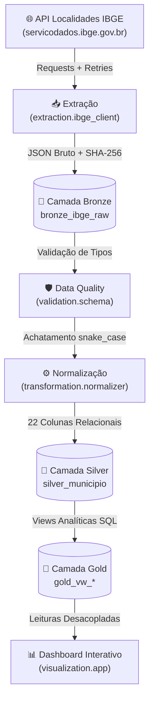

# Desafio IBGE — Engenharia de Dados (Mauá - SP)

[](https://www.python.org/)
[](https://python-poetry.org/)
[](https://github.com/astral-sh/ruff)
[]()
[](https://opensource.org/licenses/MIT)

Pipeline profissional de Engenharia de Dados desenvolvido em Python utilizando dados oficiais do IBGE sobre o município de **Mauá (SP)** (Código IBGE: `3529401`), estruturado segundo as melhores práticas de arquitetura modular, **Medallion Architecture (Bronze, Silver e Gold)** no **SQLite**, validação de contratos de dados com **Pydantic v2**, normalização tabular com **Pandas** e dashboard analítico em **Streamlit** e **Plotly**.

---

## 1. Visão Geral da Arquitetura

O ecossistema implementa o padrão Medalhão sobre o banco relacional local `data/ibge_maua.db`:



### Camadas da Medallion Architecture

1. **Camada Bronze (`bronze_ibge_raw`)**:
   - Armazena o JSON bruto da API do IBGE sem alterações, acompanhado de metadados técnicos de linhagem (`ibge_id`, `endpoint_url`, `ingestion_timestamp`, `http_status` e `checksum_sha256`).
   - Carga idempotente via `INSERT ... ON CONFLICT(ibge_id) DO UPDATE SET ...`.
2. **Camada Silver (`silver_municipio`)**:
   - Tabela relacional higienizada, tipada e achatada contendo **22 colunas** padronizadas em `snake_case`, unificando as divisões territoriais de 1989 e 2017.
   - Validação compulsória prévia via modelo Pydantic v2 (`MunicipioSchema`).
   - Rastreabilidade garantida pelo atributo `transformed_at` (UTC).
   - Carga idempotente via `INSERT ... ON CONFLICT(id) DO UPDATE SET ...`.
3. **Camada Gold (`gold_vw_*`)**:
   - SQL Views construídas sobre o SQLite para consumo analítico com custo zero de armazenamento em disco:
     - `gold_vw_municipio_hierarquia`: Nós territoriais rotulados em `snake_case` para relatórios e BI.
     - `gold_vw_qualidade_auditoria`: Auditoria contínua de conciliação Bronze vs Silver, verificação de nulos, consistência geográfica e latência de processamento em segundos.

---

## 2. Estrutura do Repositório

```text
desafio_IBGE/
├── .github/                       # Configurações de CI/CD
├── data/                          # Armazenamento local do SQLite (.gitignore)
├── docs/                          # Documentação técnica completa em MkDocs
│   ├── architecture.md            # Arquitetura Medalhão detalhada
│   ├── dashboard.md               # Especificação do Dashboard Streamlit
│   ├── doc_api.md                 # Documentação oficial da API do IBGE
│   ├── gold_analytics.md          # Camada Gold e Views de Qualidade
│   ├── index.md                   # Página inicial da documentação
│   ├── pipeline.md                # Orquestração do pipeline end-to-end
│   ├── storage.md                 # Schemas DDL e persistência SQLite
│   └── transformation.md          # Schemas Pydantic e normalização Pandas
├── src/
│   └── desafio_ibge/              # Pacote Python principal
│       ├── config/                # Constantes, URLs, IDs e paths
│       ├── extraction/            # Cliente HTTP com retries e timeouts
│       ├── loading/               # Gerenciador SQLite, DDLs e Views Gold
│       ├── transformation/        # Desaninhamento e saneamento tabular
│       ├── validation/            # Schemas Pydantic de Data Quality
│       └── visualization/         # Interface analítica Streamlit & Plotly
├── tests/                         # Suite completa de testes automatizados
│   ├── conftest.py                # Fixtures e payloads reais de Mauá
│   ├── test_config.py             # Testes de configurações
│   ├── test_extraction.py         # Testes de requisição HTTP (mockados)
│   ├── test_loading.py            # Testes de persistência Bronze, Silver e Gold
│   ├── test_transformation.py     # Testes de validação e normalização
│   └── test_visualization.py      # Testes do Dashboard com Streamlit AppTest
├── mkdocs.yml                     # Configuração do MkDocs Material
├── pyproject.toml                 # Definição de dependências e ferramentas
├── PLAN.md                        # Planejamento técnico por fases
├── README.md                      # Apresentação do projeto e guia de uso
└── SKILL.md                       # Regras e padrões obrigatórios de engenharia
```

---

## 3. Guia de Instalação e Execução

### Pré-requisitos
- **Python**: `>=3.13,<4.0` (recomendado: Python 3.13.13 via **Pyenv**)
- **Poetry**: `>=2.0`

### 3.1. Configuração do Ambiente Virtual
```powershell
# 1. Definir versão local do Python com Pyenv
pyenv local 3.13.13

# 2. Instalar dependências de produção e desenvolvimento
poetry install
```

### 3.2. Executar o Pipeline de Dados Completo (E2E)
```powershell
poetry run python -m desafio_ibge.main
# ou via atalho Taskipy:
poetry run task pipeline
```
Esse comando orquestra o fluxo completo de dados:
**Extração IBGE -> Validação Pydantic v2 -> Carga Bronze -> Normalização Silver -> Sincronização Gold & Auditoria**.

### 3.3. Executar o Dashboard Analítico
```powershell
poetry run streamlit run src/desafio_ibge/visualization/app.py
# ou via atalho Taskipy:
poetry run task dashboard
```
Acesse a interface no navegador: `http://localhost:8501`.

### 3.4. Executar Validações de Qualidade de Código
```powershell
# Verificar formatação e conformidade PEP 8 com Ruff
poetry run ruff check .

# Formatar código automaticamente
poetry run ruff format .

# Executar suite completa de 82 testes com cobertura
poetry run pytest --cov=desafio_ibge --cov-fail-under=50
```

### 3.5. Consultar a Documentação Técnica (MkDocs Material)
```powershell
# Iniciar servidor local de documentação
poetry run task docs

# Validar compilação estrita (Strict Build)
poetry run task docs-build
```

---

## 4. Governança e Fidelidade aos Dados

> [!IMPORTANT] Escopo Territorial Exclusivo
> Este pipeline consome dados estritamente da **API de Localidades do IBGE**. Não contém e não simula dados socioeconômicos (como PIB, renda ou escolaridade) ou estatísticas demográficas (população total), preservando a integridade das fontes oficiais de dados públicos.
