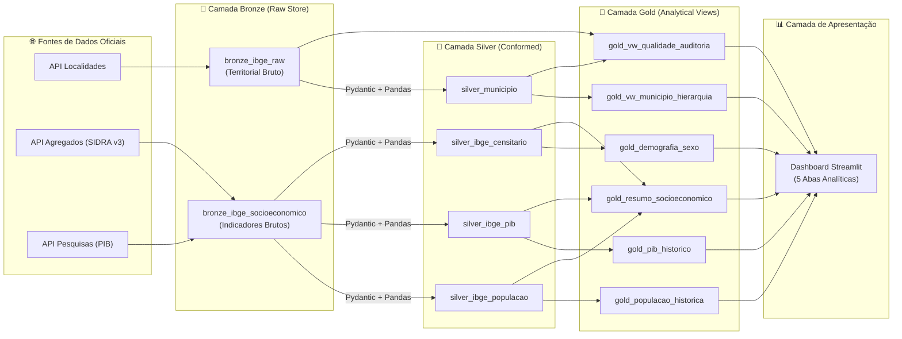

# Arquitetura de Dados: Padrão Medalhão (Bronze, Silver e Gold)

> **Projeto**: `desafio_IBGE`
> **Padrão Arquitetural**: Medallion Architecture (Bronze $\rightarrow$ Silver $\rightarrow$ Gold)
> **Engine de Armazenamento**: SQLite (`data/ibge_maua.db`)
> **Status**: Homologado e Operacional

---

## 1. Visão Geral da Arquitetura Medalhão

A **Medallion Architecture** (Arquitetura Medalhão) é um padrão consagrado de engenharia de dados que organiza os dados em três camadas de refinamento lógico progressivo:

No contexto do **`desafio_IBGE`**, a arquitetura utiliza o **SQLite** como engine relacional unificada local (`data/ibge_maua.db`), garantindo portabilidade operacional, rastreabilidade ponta a ponta e zero dependência de infraestrutura em nuvem ou serviços externos complexos.

---

## 2. Detalhamento das Camadas

### 2.1. Camada Bronze (Raw Ingestion / Raw Store)

- **Propósito**: Preservar fielmente as respostas JSON retornadas pelas APIs oficiais do IBGE, sem perda de granularidade, adicionando metadados técnicos de auditoria, carimbo de tempo UTC e hash criptográfico SHA-256.
- **Tabelas no SQLite**:
  1. `bronze_ibge_raw` (Domínio Territorial):
     - `ibge_id` (`INTEGER PRIMARY KEY`): Código identificador de 7 dígitos do município (`3529401`).
     - `endpoint_url` (`TEXT NOT NULL`): URL exata consultada.
     - `payload_json` (`TEXT NOT NULL`): Cópia integral do JSON retornado em UTF-8 com chaves canônicas ordenadas.
     - `ingestion_timestamp` (`TEXT NOT NULL`): Timestamp UTC da captura em formato ISO-8601.
     - `http_status` (`INTEGER NOT NULL`): Código de retorno HTTP (ex.: 200).
     - `checksum_sha256` (`TEXT NOT NULL`): Hash SHA-256 de 64 caracteres hexadecimais para garantia de imutabilidade e integridade.
  2. `bronze_ibge_socioeconomico` (Domínio Socioeconômico):
     - `municipio_id` (`INTEGER NOT NULL`): Código IBGE do município (`3529401`).
     - `indicador` (`TEXT NOT NULL`): Nome canônico do indicador coletado (ex.: `censo_pop_area_densidade`, `populacao_estimada_historica`, `pib_municipal_historico`, `censo_alfabetizacao`, `censo_demografia_sexo`).
     - `periodo_referencia` (`TEXT NOT NULL`): Ano ou especificação temporal da extração (`2022`, `all`, etc.).
     - `endpoint_url`, `payload_json`, `ingestion_timestamp`, `http_status`, `checksum_sha256`: Metadados idênticos de linhagem.
     - `PRIMARY KEY (municipio_id, indicador, periodo_referencia)`.
- **Garantias Operacionais**:
  - **Idempotência**: Carga baseada em cláusula `UPSERT` (`INSERT ... ON CONFLICT(...) DO UPDATE SET ...`), atualizando o carimbo de tempo sem gerar duplicações.
  - **Auditabilidade e Reprocessabilidade**: Possibilidade de recalcular ou retransformar qualquer indicador histórico a partir do payload original armazenado.

---

### 2.2. Camada Silver (Conformed & Cleansed / Curated)

- **Propósito**: Armazenar os dados estruturados em formato relacional tabular, normalizados, validados contra contratos Pydantic v2 e desaninhados com Pandas.
- **Tabelas no SQLite**:
  1. `silver_municipio` (Territorial — 22 colunas em `snake_case`):
     - Dimensão Municipal: `id` (PK), `nome`.
     - Hierarquia Tradicional (1989): `microrregiao_id`, `microrregiao_nome`, `microrregiao_mesorregiao_id`, `microrregiao_mesorregiao_nome`, `microrregiao_mesorregiao_uf_id`, `microrregiao_mesorregiao_uf_sigla`, `microrregiao_mesorregiao_uf_nome`, `microrregiao_mesorregiao_uf_regiao_id`, `microrregiao_mesorregiao_uf_regiao_sigla`, `microrregiao_mesorregiao_uf_regiao_nome`.
     - Hierarquia Contemporânea (2017): `regiao_imediata_id`, `regiao_imediata_nome`, `regiao_imediata_regiao_intermediaria_id`, `regiao_imediata_regiao_intermediaria_nome`, `regiao_imediata_regiao_intermediaria_uf_id`, `regiao_imediata_regiao_intermediaria_uf_sigla`, `regiao_imediata_regiao_intermediaria_uf_nome`, `regiao_imediata_regiao_intermediaria_uf_regiao_id`, `regiao_imediata_regiao_intermediaria_uf_regiao_sigla`, `regiao_imediata_regiao_intermediaria_uf_regiao_nome`.
     - Metadado de Linhagem: `transformed_at` (`TEXT NOT NULL`).
  2. `silver_ibge_populacao` (Série Histórica Populacional — 23 registros):
     - `municipio_id`, `ano`, `populacao`, `tipo_populacao` (`CENSO` ou `ESTIMATIVA`), `unidade_medida`, `fonte_pesquisa`, `transformed_at`.
     - `PRIMARY KEY (municipio_id, ano, tipo_populacao)`.
  3. `silver_ibge_pib` (Série Econômica em Formato Long — 227 registros):
     - `municipio_id`, `ano`, `variavel_codigo`, `variavel_nome`, `valor`, `unidade_medida`, `fonte_pesquisa`, `transformed_at`.
     - Contempla PIB a preços correntes, PIB per capita, VABs de Agropecuária, Indústria, Serviços e Administração Pública, além de Impostos.
     - `PRIMARY KEY (municipio_id, ano, variavel_codigo)`.
  4. `silver_ibge_censitario` (Indicadores Censitários do Censo 2022 — 5 registros):
     - `municipio_id`, `ano`, `variavel_codigo`, `variavel_nome`, `valor`, `unidade_medida`, `fonte_pesquisa`, `categoria`, `transformed_at`.
     - Contempla População por Sexo (Homens e Mulheres), Taxa de Alfabetização, Área Territorial e Densidade Demográfica.
     - `PRIMARY KEY (municipio_id, variavel_codigo)`.
- **Garantias Operacionais**:
  - Coerção estrita de tipos numéricos (`INTEGER`, `REAL`), eliminação de nulos espúrios e sanitização de identificadores com caracteres especiais.
  - Ausência de imputação artificial de zeros para anos ausentes ou variáveis não divulgadas.

---

### 2.3. Camada Gold (Analytical & Consumption / Business Ready)

- **Propósito**: Disponibilizar modelos analíticos semânticos consumíveis diretamente pelo Dashboard Streamlit e relatórios executivos.
- **Implementação**: Construída exclusivamente sobre **SQL Views** (`CREATE VIEW IF NOT EXISTS`), garantindo atualização em tempo real, consistência relacional e custo zero de duplicação física em disco.
- **Visões SQL Disponíveis**:
  1. `gold_vw_municipio_hierarquia`:
     - Visão analítica unificando as divisões territoriais de 1989 e 2017 de Mauá em rótulos humanizados.
  2. `gold_vw_qualidade_auditoria`:
     - Visão de governança e auditoria operacional, correlacionando Bronze e Silver via semântica de `FULL OUTER JOIN`, computando flags de conformidade, integridade de checksums e latência de processamento em segundos.
  3. `gold_populacao_historica`:
     - Série temporal populacional unificada (2001–2026), calculando crescimento anual absoluto e percentual via window function `LAG()` particionada por metodologia, com sinalização de descontinuidades temporais.
  4. `gold_pib_historico`:
     - Série temporal econômica completa (1999–2023) consolidando PIB nominal, PIB per capita e cálculo de participações relativas setoriais ao VAB Total protegidas com `NULLIF()`.
  5. `gold_demografia_sexo`:
     - Estrutura demográfica do Censo 2022, calculando contagens absolutas, percentuais relativos e Razão de Sexo oficial (homens por 100 mulheres).
  6. `gold_resumo_socioeconomico`:
     - Síntese executiva multitemática reunindo os indicadores mais recentes homologados de Mauá em formato tabular de fácil apresentação.

---

## 3. Matriz Comparativa entre as Camadas

| Dimensão de Análise | Camada Bronze | Camada Silver | Camada Gold |
| :--- | :--- | :--- | :--- |
| **Objetos no SQLite** | Tabelas `bronze_ibge_raw` e `bronze_ibge_socioeconomico` | Tabelas `silver_municipio`, `silver_ibge_populacao`, `silver_ibge_pib`, `silver_ibge_censitario` | Views `gold_vw_*`, `gold_populacao_historica`, `gold_pib_historico`, etc. |
| **Formato dos Dados** | JSON bruto original em texto com metadados | Relacional tabular tipado em `snake_case` | Modelos analíticos, séries temporais e KPIs |
| **Origem do Dado** | APIs Oficiais IBGE (Localidades, SIDRA, Pesquisas) | Ingerido da Bronze após validação Pydantic e normalização | Consultas SQL declarativas sobre a Silver |
| **Estado de Qualidade** | Raw auditado (com hash SHA-256 e HTTP status) | Higienizado, sem hífens, tipado, livre de nulos espúrios | Enriquecido com métricas derivadas (`LAG`, `NULLIF`, somas) |
| **Estratégia de Carga** | `INSERT ... ON CONFLICT DO UPDATE` (UPSERT) | `INSERT ... ON CONFLICT DO UPDATE` (UPSERT) | `CREATE VIEW` (cálculo sob demanda, sem duplicação em disco) |
| **Público Consumidor** | Pipelines internos de reprocessamento e auditoria | Engenheiros de Dados e cientistas de dados | Dashboards Streamlit, analistas de negócio e tomadores de decisão |

---

## 4. Governança Temporal e Restrições Metodológicas

> [!IMPORTANT]
> **Fidelidade Metodológica e Preservação de Períodos de Referência**:
> As pesquisas estatísticas do IBGE possuem naturezas metodológicas e cronogramas de publicação distintos:
> 1. **Censo Demográfico (2022)**: Contagem exaustiva decenal da população de fato e de direito.
> 2. **Contas Regionais do PIB (1999–2023)**: Estimativa macroeconômica publicada com defasagem estrutural de aproximadamente 2 anos.
> 3. **Estimativas de População (2001–2026)**: Modelagem matemática anual para fins legais e orçamentários.
>
> **É mandatório manter a rastreabilidade explícita do `ano_referencia` e da `fonte_pesquisa` em todas as camadas**, evitando concatenações espúrias de séries temporais metodologicamente incompatíveis.
