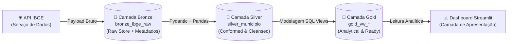

# Arquitetura de Dados: Padrão Medalhão (Bronze, Silver e Gold)

> **Projeto**: `desafio_IBGE`
> **Padrão Arquitetural**: Medallion Architecture (Bronze $\rightarrow$ Silver $\rightarrow$ Gold)
> **Engine de Armazenamento**: SQLite (`data/ibge_maua.db`)
> **Status**: Planejado e Documentado

---

## 1. Visão Geral da Arquitetura Medalhão

A **Medallion Architecture** (Arquitetura Medalhão) é um padrão de design de engenharia de dados que organiza os dados em três camadas de refinamento lógico progressivo:

No contexto do **`desafio_IBGE`**, a arquitetura utiliza o **SQLite** como repositório unificado local, garantindo simplicidade operacional, rastreabilidade de ponta a ponta e zero dependências pesadas de infraestrutura.

---

## 2. Detalhamento das Camadas

### 2.1. Camada Bronze (Raw Ingestion / Raw Store)

- **Propósito**: Preservar fielmente o payload JSON retornado pela API oficial do IBGE, sem perda de granularidade, adicionando metadados de auditoria e linhagem de dados.
- **Estrutura no SQLite**: Tabela `bronze_ibge_raw`.
- **Atributos de Metadados**:
  - `ibge_id` (`INTEGER PRIMARY KEY`): Código identificador de 7 dígitos do município (`3529401`).
  - `endpoint_url` (`TEXT NOT NULL`): URL exata consultada no IBGE.
  - `payload_json` (`TEXT NOT NULL`): Cópia integral e intocada do JSON retornado pela API (UTF-8).
  - `ingestion_timestamp` (`TIMESTAMP NOT NULL`): Data e hora UTC do momento da captura.
  - `http_status` (`INTEGER NOT NULL`): Código de status HTTP da requisição (ex.: 200).
  - `checksum_sha256` (`TEXT NOT NULL`): Hash criptográfico do payload para auditoria de integridade e idempotência.
- **Garantias Operacionais**:
  - **Idempotência**: Carga via `UPSERT` (`INSERT ... ON CONFLICT(ibge_id) DO UPDATE SET ...`), evitando duplicações e atualizando o carimbo de tempo.
  - **Auditabilidade**: Permite reproduzir qualquer transformação futura a partir do dado bruto histórico.

---

### 2.2. Camada Silver (Conformed & Cleansed / Curated)

- **Propósito**: Conter a entidade canônica municipal em formato relacional tabular, higienizada, validada contra o contrato Pydantic (`MunicipioSchema`) e desaninhada com Pandas (`json_to_dataframe`).
- **Estrutura no SQLite**: Tabela `silver_municipio`.
- **Atributos Relacionais (22 Colunas em `snake_case`)**:
  - **Dimensão Municipal**: `id` (PK), `nome`.
  - **Hierarquia Tradicional (1989)**: `microrregiao_id`, `microrregiao_nome`, `microrregiao_mesorregiao_id`, `microrregiao_mesorregiao_nome`, `microrregiao_mesorregiao_uf_id`, `microrregiao_mesorregiao_uf_sigla`, `microrregiao_mesorregiao_uf_nome`, `microrregiao_mesorregiao_uf_regiao_id`, `microrregiao_mesorregiao_uf_regiao_sigla`, `microrregiao_mesorregiao_uf_regiao_nome`.
  - **Hierarquia Contemporânea (2017)**: `regiao_imediata_id`, `regiao_imediata_nome`, `regiao_imediata_regiao_intermediaria_id`, `regiao_imediata_regiao_intermediaria_nome`, `regiao_imediata_regiao_intermediaria_uf_id`, `regiao_imediata_regiao_intermediaria_uf_sigla`, `regiao_imediata_regiao_intermediaria_uf_nome`, `regiao_imediata_regiao_intermediaria_uf_regiao_id`, `regiao_imediata_regiao_intermediaria_uf_regiao_sigla`, `regiao_imediata_regiao_intermediaria_uf_regiao_nome`.
  - **Metadado de Processamento**: `transformed_at` (`TIMESTAMP NOT NULL`).
- **Garantias Operacionais**:
  - Saneamento de hífens (`regiao-imediata` $\rightarrow$ `regiao_imediata`).
  - Restrições relacionais explícitas (`NOT NULL`, chaves primárias e tipos SQL estritos).
  - Carga idempotente via `UPSERT` baseado na chave primária `id`.

---

### 2.3. Camada Gold (Analytical & Consumption / Business Ready)

- **Propósito**: Disponibilizar visões analíticas orientadas a negócio e consumo direto pelo Dashboard Streamlit, aggregations e modelos dimensionais.
- **Implementação no SQLite**: `SQL Views` construídas sobre a camada Silver, garantindo zero redundância física e atualização em tempo real.
- **Visões Planejadas**:
  1. `gold_vw_municipio_hierarquia`:
     - Visão analítica consolidando todas as dimensões territoriais e regionais de Mauá.
     - Colunas calculadas de classificação geográfica (ex.: flags analíticas `pertence_regiao_metropolitana`, `pertence_imediata_sp`).
     - Códigos canônicos padronizados prontos para cruzamento com bases externas (como o Censo e o SIDRA).
  2. `gold_vw_qualidade_auditoria`:
     - Visão de integridade e linhagem de dados, correlacionando timestamps da camada Bronze (`ingestion_timestamp`) com a Silver (`transformed_at`), status de integridade do código IBGE e frescor da informação.

> [!IMPORTANT]
> **Governança de Dados na Camada Gold**:
> Conforme documentado em [`docs/doc_api.md`](file:///c:/Users/Jones/projeto/desafio_IBGE/docs/doc_api.md), a API de Localidades do IBGE **NÃO** fornece indicadores como População, PIB ou Renda. A camada Gold conterá **exclusivamente métricas analíticas e classificações suportadas pela base de dados oficial**, sem criação de dados fictícios.

---

## 3. Matriz Comparativa entre as Camadas

| Dimensão de Análise | Camada Bronze | Camada Silver | Camada Gold |
| :--- | :--- | :--- | :--- |
| **Objeto no SQLite** | Tabela `bronze_ibge_raw` | Tabela `silver_municipio` | Views `gold_vw_*` |
| **Formato dos Dados** | JSON bruto em texto (`payload_json`) | Relacional tabular (22 colunas tipadas) | Modelo analítico / dimensional |
| **Origem do Dado** | API Oficial IBGE (HTTP GET) | Extraído da Bronze via Pydantic/Pandas | Consultas SQL sobre a Silver |
| **Estado de Qualidade** | Raw (não validado) | Higienizado, sem hífens, tipado | Enriquecido para consumo analítico |
| **Estratégia de Escrita**| `INSERT ... ON CONFLICT DO UPDATE` | `INSERT ... ON CONFLICT DO UPDATE` | `CREATE VIEW` (sem armazenamento físico) |
| **Público Consumidor** | Pipelines internos de reprocessamento | Engenheiros de Dados e ETL | Analistas, Cientistas e Dashboards |
