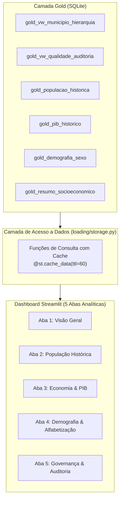

# Dashboard Interativo (Streamlit & Plotly)

> **Camada do Pipeline**: Apresentação & Visualização
> **Módulo**: `src/desafio_ibge/visualization/app.py`
> **Tecnologias**: Streamlit, Plotly Express, Pandas
> **Status**: Homologado e Operacional

---

## 1. Visão Geral da Camada de Visualização

O **Dashboard Interativo** do projeto **`desafio_IBGE`** materializa a camada de consumo analítico da *Medallion Architecture*.

Construído em **Streamlit** e enriquecido com gráficos dinâmicos do **Plotly Express**, o aplicativo consome exclusivamente as visões modeladas na camada Gold e as métricas operacionais da camada Silver/Bronze, proporcionando uma experiência de exploração abrangente sobre a realidade territorial, populacional, econômica e demográfica de **Mauá (SP)**.



---

## 2. Como Executar o Dashboard

Para iniciar a aplicação no ambiente virtual local:

```bash
# Execução direta via Streamlit
poetry run streamlit run src/desafio_ibge/visualization/app.py

# Ou via atalho Taskipy
poetry run task dashboard
```

O Streamlit disponibilizará a aplicação no navegador em `http://localhost:8501`.

---

## 3. Detalhamento das 5 Abas Analíticas

### 3.1. Aba 1 — Visão Geral Territorial & Socioeconômica
- **Cards Estratégicos**: Apresenta os indicadores-chave do município com seus respectivos anos e fontes oficiais:
  - População Censitária (418.261 hab — Censo 2022)
  - População Estimada Recente (429.064 hab — 2026)
  - PIB a Preços Correntes (R$ 25,00 bilhões — 2023)
  - PIB per capita (R$ 59.773,04 — 2023)
  - Área Territorial Oficial (61,937 km²)
  - Densidade Demográfica (6.753,01 hab/km²)
  - Taxa de Alfabetização (96,74%)
  - Razão de Sexo (92,82 homens por 100 mulheres)
- **Identificação Territorial**: Hierarquia completa de Mauá (Mesorregião, Microrregião, Regiões Imediata e Intermediária).
- **Tabela Analítica**: Exibição tabular interativa com mecanismo de busca e botão de exportação em **CSV**.

### 3.2. Aba 2 — População Histórica
- **Gráfico Temporal com Plotly**: Linha de evolução com marcadores distintos para contagens do Censo Demográfico versus Estimativas anuais de população (2001 a 2026).
- **Filtro Interativo**: Slider de intervalo de anos permitindo recorte temporal sob demanda.
- **Métricas de Dinâmica Populacional**: Variação absoluta e crescimento percentual acumulado no intervalo selecionado.
- **Aviso Metodológico**: Destaque para descontinuidades de amostragem entre operações censitárias e estimativas matemáticas.

### 3.3. Aba 3 — Economia & PIB
- **Gráficos Econômicos**:
  - Evolução do Produto Interno Bruto a preços correntes (1999–2023).
  - Evolução do PIB per capita em reais correntes.
  - Composição setorial do Valor Adicionado Bruto (Agropecuária, Indústria, Serviços e Administração Pública) em área empilhada percentual.
- **Governança de Defasagem**: Alerta explícito sobre a defasagem temporal de 2 anos nas Contas Regionais e distinção entre crescimento nominal versus real.

### 3.4. Aba 4 — Demografia & Alfabetização
- **Pirâmide e Distribuição por Sexo**: Gráfico de rosca e barras comparativas destacando 201.348 homens (48,14%) e 216.913 mulheres (51,86%).
- **Razão de Sexo Oficial**: Destaque para a proporção estatística de 92,82 homens para cada 100 mulheres.
- **Educação e Território**: Visualização da taxa de alfabetização da população com 15 anos ou mais (96,74%) e métricas de densidade urbana.

### 3.5. Aba 5 — Governança & Auditoria
- **Volumetria Medallion Integrada**: Gráfico e tabela discriminando o volume real de registros entre o domínio Territorial e o domínio Socioeconômico (totalizando **322 registros reais no SQLite**).
- **Métricas de Data Quality**: Taxa de conformidade do pipeline (100%), ausência de nulos em atributos mandatórios e integridade dos códigos IBGE.
- **Linhagem e Latência**: Carimbos UTC de captura na Bronze e transformação na Silver, com latência média de execução em segundos.
- **Catálogo de Metadados**: Relação de tabelas e views com descrições formais, chaves primárias e granularidade.

---

## 4. Performance, Resiliência e Testes de Interface

- **Cache Inteligente**: Decoração com `@st.cache_data(ttl=60)` em todas as funções de leitura, eliminando requisições repetidas ao banco de dados durante interações do usuário.
- **Botão de Atualização**: Gatilho na barra lateral que aciona `st.cache_data.clear()` e recarrega os dados imediatamente.
- **Degradação Suave (Graceful Fallback)**: Se o banco de dados ainda não foi criado ou se encontrar vazio, a aplicação intercepta a condição e exibe alertas amigáveis (`st.warning()`), instruindo o usuário a executar o pipeline sem quebrar a interface.
- **Testes Automatizados de Interface**: A suíte de testes em `tests/test_visualization.py` utiliza `streamlit.testing.v1.AppTest` para validar a inicialização, renderização de abas e componentes sob múltiplos cenários de banco de dados (banco inexistente, banco vazio, banco territorial e banco completo).
