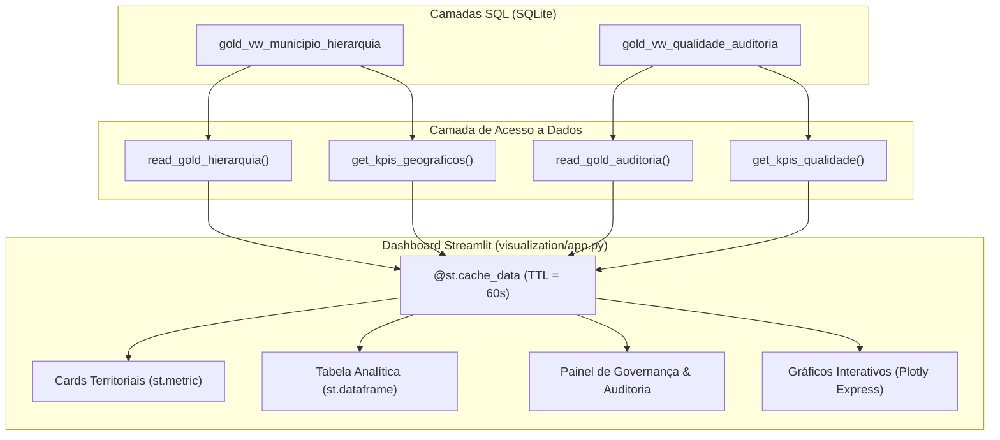

# Dashboard Interativo (Streamlit & Plotly)

O **Dashboard Interativo** do projeto **`desafio_IBGE`** é a interface analítica e de governança que materializa a camada de apresentação da *Medallion Architecture*.

Construído com **Streamlit** e **Plotly Express**, o aplicativo consome exclusivamente os dados processados e modelados nas camadas SQL (com ênfase na camada Gold), exibindo a malha territorial e o monitoramento contínuo de qualidade de dados (Data Quality) do município de **Mauá (SP)**.

---

## 1. Arquitetura da Camada de Visualização

O dashboard adota um padrão de arquitetura desacoplada: a interface web não executa regras de negócio, transformações pesadas ou conexões diretas descontroladas ao banco de dados. Em vez disso, consome os contratos e funções utilitárias fornecidos pelo pacote `desafio_ibge.loading`:



---

## 2. Dependências Necessárias

As dependências foram integradas ao ambiente do projeto via Poetry:

- **Streamlit (`^1.66.1`)**: Framework reativo para construção de dashboards analíticos em Python.
- **Plotly (`^7.1.0`)**: Biblioteca para geração de gráficos estatísticos interativos.
- **Pandas (`^3.1.0`)**: Manipulação e renderização tabular.
- **SQLite3**: Driver relacional padrão do Python.

---

## 3. Como Executar o Dashboard

Para iniciar o servidor local do Streamlit a partir da raiz do projeto:

```powershell
poetry run streamlit run src/desafio_ibge/visualization/app.py
```

Ou através do atalho configurado no Taskipy:

```powershell
poetry run task dashboard
```

O Streamlit disponibilizará a aplicação no navegador (geralmente em `http://localhost:8501`).

---

## 4. Origem dos Dados e Contratos Consumidos

Os dados apresentados derivam exclusivamente dos endpoints oficiais do IBGE:
- **API Fonte:** `https://servicodados.ibge.gov.br/api/v1/localidades/municipios/3529401`
- **Tabelas e Views Utilizadas:**
  - `silver_municipio`: Tabela física contendo os 22 atributos relacionais em `snake_case`.
  - `gold_vw_municipio_hierarquia`: View que unifica a árvore territorial de 1989 e 2017.
  - `gold_vw_qualidade_auditoria`: View de auditoria cruzando Bronze e Silver.

---

## 5. Estrutura e Indicadores Apresentados

O dashboard está organizado em seções e abas:

### 5.1. Painel Lateral (Sidebar)
- Identificação do banco SQLite ativo.
- Botão **"🔄 Atualizar Dados"** (limpa o cache em memória e força nova leitura).
- Links diretos para os endpoints e documentação oficial da API do IBGE.

### 5.2. Identificação Territorial (Cards Principais)
Utiliza `st.metric()` para os atributos de primeiro nível de Mauá:
- **Município:** Mauá (Código IBGE: `3529401`).
- **Estado (UF):** São Paulo (SP) — Cód. `35`.
- **Macrorregião:** Sudeste (SE) — Cód. `3`.
- **Mesorregião (1989):** Metropolitana de São Paulo.
- **Microrregião (1989):** São Paulo.
- **Região Imediata (2017):** São Paulo (Cód. `350001`).
- **Região Intermediária (2017):** São Paulo (Cód. `3501`).

### 5.3. Aba 1 — Tabela Analítica
- Exibe o DataFrame com nomes de colunas humanizados em português.
- Campo de busca textual por código IBGE ou nome do município.
- Botão para exportação dos dados da visualização em formato **CSV**.

### 5.4. Aba 2 — Governança & Data Quality
- **Taxa de Conformidade:** Percentual de sincronismo entre as camadas Bronze e Silver (`100%`).
- **Contadores de Camadas:** Registros na Bronze vs Registros na Silver.
- **Falhas de Qualidade:** Somatório de campos nulos e assincronias detectadas.
- **Metadados de Freshness:** Data/hora UTC da última ingestão e transformação.
- **Latência de Processamento:** Tempo decorrido em segundos entre a captura bruta e a carga relacional.
- **Expansor de Log SQL:** Visualização do registro atômico retornado por `gold_vw_qualidade_auditoria`.

### 5.5. Aba 3 — Visualizações Gráficas (Plotly Express)
- **Comparativo por Camada:** Gráfico de barras categorizado com o volume de dados nas camadas Bronze, Silver e Gold.
- **Conformidade de Regras:** Gráfico de barras horizontal demonstrando a validação atômica de código IBGE, checksum SHA-256, status HTTP 200 e consistência entre as divisões regionais.

---

## 6. Performance e Política de Cache

- **Decorator `@st.cache_data(ttl=60)`**: As quatro funções de carregamento (`load_hierarquia_data`, `load_auditoria_data`, `load_kpis_geograficos`, `load_kpis_qualidade`) mantêm cache em memória com validade de 60 segundos.
- **Atualização sob Demanda**: O botão **"🔄 Atualizar Dados"** aciona `st.cache_data.clear()` e re-executa a aplicação (`st.rerun()`), garantindo que novas cargas de dados sejam visualizadas imediatamente.
- **Segurança de Conexões**: Nenhuma conexão SQLite é compartilhada entre requisições; cada leitura é gerenciada pontualmente por context managers.

---

## 7. Tratamento de Situações Sem Dados e Erros

1. **Banco Inexistente ou Camada Gold Vazia:**
   - O aplicativo detecta que `df_hierarquia.empty` é verdadeiro e exibe um alerta amigável (`st.warning()`), instruindo o usuário sobre o comando de ingestão necessário, sem quebrar ou gerar telas de erro desnecessárias.
2. **Falha Operacional no Banco SQLite:**
   - Erros de I/O ou corrupção no banco são interceptados via bloco `try/except`, exibindo uma mensagem limpa (`st.error()`) e registrando o rastreio técnico nos logs da aplicação via `logger.exception`.

---

## 8. Limitações Conhecidas

> [!WARNING] Escopo de Dados Disponíveis
> Como a fonte oficial é a API de Localidades do IBGE e o escopo do projeto é focado no município de **Mauá (SP)**, o banco de dados contém uma única entidade municipal. O dashboard foi rigorosamente calibrado para refletir com fidelidade esse volume, abstendo-se de gerar gráficos de dispersão ou séries temporais artificiais que sugerissem um volume de dados inexistente.
