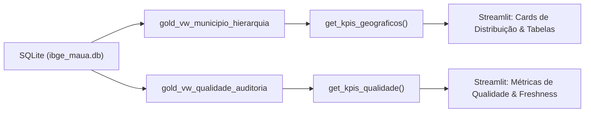

# Modelagem Analítica SQL — Camada Gold (Views e Métricas)

A **Camada Gold** representa o nível de consumo analítico da *Medallion Architecture* no projeto **`desafio_IBGE`**.

Implementada inteiramente via **SQL Views** sobre o banco relacional SQLite local (`data/ibge_maua.db`), a camada Gold disponibiliza dados modelados, rotulados e agregados com custo zero de duplicação de dados em disco, servindo como camada semântica e contrato oficial para o futuro Dashboard interativo em Streamlit.

---

## 1. Visão Geral e Princípios de Design

1. **Sem Redundância Física**: Construída exclusivamente sobre SQL Views (`CREATE VIEW`), consumindo dinamicamente as camadas Silver e Bronze.
2. **Separação de Preocupações**:
   - `gold_vw_municipio_hierarquia`: Foco no consumo analítico territorial e visualização.
   - `gold_vw_qualidade_auditoria`: Foco em governança, integridade referencial, detecção de nulos e latência.
3. **Fidelidade Estrita aos Dados**: Nenhuma coluna fictícia (PIB, população, renda) é inferida ou simulada. Reflete estritamente os atributos oficiais da API de Localidades do IBGE.
4. **Resiliência a Órfãos**: A view de auditoria implementa a semântica de `FULL OUTER JOIN` via `UNION ALL`, identificando tanto registros presentes na Bronze e ausentes na Silver (`AUSENTE_NA_SILVER`) quanto registros na Silver sem lastro bruto (`AUSENTE_NA_BRONZE`).

---

## 2. View Analítica: `gold_vw_municipio_hierarquia`

### 2.1. Objetivo e Grão
Consolidar a árvore territorial do município em rótulos amigáveis e padronizados em `snake_case`, unificando a **Divisão Regional de 1989** (Mesorregião e Microrregião) e a **Divisão Regional de 2017** (Região Intermediária e Região Imediata).

- **Grão**: 1 linha por município (`municipio_id`).

### 2.2. Dicionário de Dados

| Coluna | Tipo SQLite | Descrição Técnica | Exemplo (Mauá) |
| :--- | :--- | :--- | :--- |
| `municipio_id` | `INTEGER` | Código IBGE oficial do município (7 dígitos) | `3529401` |
| `municipio_nome` | `TEXT` | Nome oficial do município com acentuação correta | `Mauá` |
| `uf_id` | `INTEGER` | Código da Unidade Federativa | `35` |
| `uf_sigla` | `TEXT` | Sigla da Unidade Federativa | `SP` |
| `uf_nome` | `TEXT` | Nome completo do estado | `São Paulo` |
| `regiao_id` | `INTEGER` | Código da Macrorregião do Brasil | `3` |
| `regiao_sigla` | `TEXT` | Sigla da Macrorregião | `SE` |
| `regiao_nome` | `TEXT` | Nome oficial da grande região | `Sudeste` |
| `regiao_imediata_id` | `INTEGER` | Identificador da Região Geográfica Imediata (2017) | `350001` |
| `regiao_imediata_nome` | `TEXT` | Nome da Região Geográfica Imediata | `São Paulo` |
| `regiao_intermediaria_id` | `INTEGER` | Identificador da Região Intermediária (2017) | `3501` |
| `regiao_intermediaria_nome` | `TEXT` | Nome da Região Geográfica Intermediária | `São Paulo` |
| `microrregiao_id` | `INTEGER` | Identificador da Microrregião (1989) | `35061` |
| `microrregiao_nome` | `TEXT` | Nome da Microrregião | `São Paulo` |
| `mesorregiao_id` | `INTEGER` | Identificador da Mesorregião (1989) | `3515` |
| `mesorregiao_nome` | `TEXT` | Nome da Mesorregião | `Metropolitana de São Paulo` |
| `transformed_at` | `TEXT` | Timestamp UTC em que a linha Silver foi gerada | `2026-10-30T20:20:00+00:00` |

### 2.3. Código SQL DDL

```sql
CREATE VIEW IF NOT EXISTS gold_vw_municipio_hierarquia AS
SELECT
    id AS municipio_id,
    nome AS municipio_nome,
    microrregiao_mesorregiao_uf_id AS uf_id,
    microrregiao_mesorregiao_uf_sigla AS uf_sigla,
    microrregiao_mesorregiao_uf_nome AS uf_nome,
    microrregiao_mesorregiao_uf_regiao_id AS regiao_id,
    microrregiao_mesorregiao_uf_regiao_sigla AS regiao_sigla,
    microrregiao_mesorregiao_uf_regiao_nome AS regiao_nome,
    regiao_imediata_id AS regiao_imediata_id,
    regiao_imediata_nome AS regiao_imediata_nome,
    regiao_imediata_regiao_intermediaria_id AS regiao_intermediaria_id,
    regiao_imediata_regiao_intermediaria_nome AS regiao_intermediaria_nome,
    microrregiao_id AS microrregiao_id,
    microrregiao_nome AS microrregiao_nome,
    microrregiao_mesorregiao_id AS mesorregiao_id,
    microrregiao_mesorregiao_nome AS mesorregiao_nome,
    transformed_at
FROM silver_municipio;
```

---

## 3. View de Qualidade e Governança: `gold_vw_qualidade_auditoria`

### 3.1. Objetivo e Grão
Cruzar as informações operacionais da camada Bronze (`bronze_ibge_raw`) e da camada Silver (`silver_municipio`), expondo métricas atômicas de qualidade de dados (Data Quality), conformidade de schema, integridade de checksums e latência de processamento.

- **Grão**: 1 linha por registro/município sob governança no ecossistema de dados.

### 3.2. Dicionário de Dados e Regras de Negócio

| Coluna | Tipo SQLite | Regra Técnica / Descrição |
| :--- | :--- | :--- |
| `bronze_ibge_id` | `INTEGER` | Chave primária da camada Bronze (`NULL` se órfão na Silver) |
| `silver_id` | `INTEGER` | Chave primária da camada Silver (`NULL` se órfão na Bronze) |
| `municipio_id` | `INTEGER` | Código do município unificado via `COALESCE(b.ibge_id, s.id)` |
| `municipio_nome` | `TEXT` | Nome do município na Silver (`'NÃO DISPONÍVEL NA SILVER'` se pendente) |
| `endpoint_url` | `TEXT` | URL original consultada na API do IBGE |
| `http_status` | `INTEGER` | Código de retorno HTTP da extração |
| `checksum_sha256` | `TEXT` | Hash SHA-256 do payload JSON bruto |
| `ingestion_timestamp` | `TEXT` | Timestamp UTC da coleta na camada Bronze |
| `transformed_at` | `TEXT` | Timestamp UTC da transformação e carga na Silver |
| `flag_presente_bronze` | `INTEGER` | `1` se existe registro bruto na Bronze, `0` caso contrário |
| `flag_presente_silver` | `INTEGER` | `1` se existe registro estruturado na Silver, `0` caso contrário |
| `status_integracao` | `TEXT` | `'CONFORME'`, `'AUSENTE_NA_SILVER'` ou `'AUSENTE_NA_BRONZE'` |
| `flag_codigo_ibge_valido` | `INTEGER` | `1` se o código possui 7 dígitos (entre 1000000 e 9999999), `0` caso contrário |
| `flag_checksum_valido` | `INTEGER` | `1` se o hash SHA-256 possui exatamente 64 caracteres hexadecimais |
| `flag_http_ok` | `INTEGER` | `1` se `http_status == 200`, `0` caso contrário |
| `flag_campos_obrigatorios_nulos` | `INTEGER` | `1` se algum campo obrigatório na Silver (`nome`, `uf`, regiões) for nulo/vazio, `0` se íntegro |
| `flag_consistencia_geografica` | `INTEGER` | `1` se a UF e Região Macro coincidem entre divisões 1989 e 2017; `NULL` se não estiver na Silver |
| `latencia_processamento_segundos` | `REAL` | Diferença em segundos: `(julianday(transformed_at) - julianday(ingestion_timestamp)) * 86400` |

### 3.3. Código SQL DDL

```sql
CREATE VIEW IF NOT EXISTS gold_vw_qualidade_auditoria AS
SELECT
    b.ibge_id AS bronze_ibge_id,
    s.id AS silver_id,
    COALESCE(b.ibge_id, s.id) AS municipio_id,
    COALESCE(s.nome, 'NÃO DISPONÍVEL NA SILVER') AS municipio_nome,
    b.endpoint_url,
    b.http_status,
    b.checksum_sha256,
    b.ingestion_timestamp,
    s.transformed_at,
    CASE WHEN b.ibge_id IS NOT NULL THEN 1 ELSE 0 END AS flag_presente_bronze,
    CASE WHEN s.id IS NOT NULL THEN 1 ELSE 0 END AS flag_presente_silver,
    CASE
        WHEN b.ibge_id IS NOT NULL AND s.id IS NOT NULL THEN 'CONFORME'
        WHEN b.ibge_id IS NOT NULL AND s.id IS NULL THEN 'AUSENTE_NA_SILVER'
        WHEN b.ibge_id IS NULL AND s.id IS NOT NULL THEN 'AUSENTE_NA_BRONZE'
        ELSE 'INDEFINIDO'
    END AS status_integracao,
    CASE
        WHEN (b.ibge_id BETWEEN 1000000 AND 9999999)
             OR (s.id BETWEEN 1000000 AND 9999999)
        THEN 1
        ELSE 0
    END AS flag_codigo_ibge_valido,
    CASE
        WHEN b.checksum_sha256 IS NOT NULL AND length(b.checksum_sha256) = 64
        THEN 1
        ELSE 0
    END AS flag_checksum_valido,
    CASE
        WHEN b.http_status = 200 THEN 1
        ELSE 0
    END AS flag_http_ok,
    CASE
        WHEN s.id IS NOT NULL AND (
            s.nome IS NULL OR trim(s.nome) = '' OR
            s.microrregiao_id IS NULL OR
            s.microrregiao_mesorregiao_uf_sigla IS NULL OR
            s.regiao_imediata_id IS NULL
        ) THEN 1
        ELSE 0
    END AS flag_campos_obrigatorios_nulos,
    CASE
        WHEN s.id IS NOT NULL AND (
            s.microrregiao_mesorregiao_uf_sigla =
                s.regiao_imediata_regiao_intermediaria_uf_sigla
            AND s.microrregiao_mesorregiao_uf_regiao_sigla =
                s.regiao_imediata_regiao_intermediaria_uf_regiao_sigla
        ) THEN 1
        WHEN s.id IS NOT NULL THEN 0
        ELSE NULL
    END AS flag_consistencia_geografica,
    CASE
        WHEN b.ingestion_timestamp IS NOT NULL AND s.transformed_at IS NOT NULL
        THEN ROUND(
            (julianday(s.transformed_at) - julianday(b.ingestion_timestamp)) * 86400.0,
            2
        )
        ELSE NULL
    END AS latencia_processamento_segundos
FROM bronze_ibge_raw b
LEFT JOIN silver_municipio s ON b.ibge_id = s.id

UNION ALL

SELECT
    NULL AS bronze_ibge_id,
    s.id AS silver_id,
    s.id AS municipio_id,
    s.nome AS municipio_nome,
    NULL AS endpoint_url,
    NULL AS http_status,
    NULL AS checksum_sha256,
    NULL AS ingestion_timestamp,
    s.transformed_at,
    0 AS flag_presente_bronze,
    1 AS flag_presente_silver,
    'AUSENTE_NA_BRONZE' AS status_integracao,
    CASE
        WHEN s.id BETWEEN 1000000 AND 9999999 THEN 1
        ELSE 0
    END AS flag_codigo_ibge_valido,
    0 AS flag_checksum_valido,
    0 AS flag_http_ok,
    CASE
        WHEN (
            s.nome IS NULL OR trim(s.nome) = '' OR
            s.microrregiao_id IS NULL OR
            s.microrregiao_mesorregiao_uf_sigla IS NULL OR
            s.regiao_imediata_id IS NULL
        ) THEN 1
        ELSE 0
    END AS flag_campos_obrigatorios_nulos,
    CASE
        WHEN (
            s.microrregiao_mesorregiao_uf_sigla =
                s.regiao_imediata_regiao_intermediaria_uf_sigla
            AND s.microrregiao_mesorregiao_uf_regiao_sigla =
                s.regiao_imediata_regiao_intermediaria_uf_regiao_sigla
        ) THEN 1
        ELSE 0
    END AS flag_consistencia_geografica,
    NULL AS latencia_processamento_segundos
FROM silver_municipio s
WHERE s.id NOT IN (SELECT ibge_id FROM bronze_ibge_raw);
```

---

## 4. Consumo Programático em Python / Pandas

O pacote `desafio_ibge.loading` disponibiliza funções de alto nível com tipagem estrita para consumo direto pelo futuro Dashboard:

```python
from desafio_ibge.loading import (
    read_gold_hierarquia,
    read_gold_auditoria,
    get_kpis_geograficos,
    get_kpis_qualidade,
)

# 1. Recuperar a hierarquia de Mauá em DataFrame Pandas
df_hierarquia = read_gold_hierarquia(municipio_id=3529401)
print(df_hierarquia[["municipio_nome", "uf_sigla", "mesorregiao_nome"]])

# 2. Obter métricas de auditoria
df_auditoria = read_gold_auditoria(municipio_id=3529401)
print(df_auditoria[["municipio_nome", "status_integracao", "latencia_processamento_segundos"]])

# 3. Sumarização de KPIs territoriais
kpis_geo = get_kpis_geograficos()
print(f"Total de Municípios: {kpis_geo['total_municipios']}")
print(f"Por Região: {kpis_geo['municipios_por_regiao']}")

# 4. Indicadores de Governança
kpis_dq = get_kpis_qualidade()
print(f"Taxa de Conformidade: {kpis_dq['taxa_conformidade_pct']}%")
print(f"Última Ingestão: {kpis_dq['ultima_ingestao_utc']}")
```

---

## 5. Contrato de Dados para o Dashboard Streamlit (Fase 7)

A interface visual do Streamlit consumirá estritamente as seguintes estruturas fornecidas pelas funções utilitárias:



### Contrato de Métricas de Qualidade (`get_kpis_qualidade`)
- `total_registros_auditados`: Contagem total de entidades no pipeline (`int`).
- `taxa_conformidade_pct`: Porcentagem de registros íntegros (`float`, ex: `100.0`).
- `total_falhas_qualidade`: Soma de campos nulos e assincronias (`int`).
- `latencia_media_segundos`: Latência média de processamento (`float | None`).
- `ultima_ingestao_utc`: Carimbo ISO-8601 da última extração (`str | None`).
- `ultima_transformacao_utc`: Carimbo ISO-8601 da última carga Silver (`str | None`).

---

## 6. Limitações Conhecidas dos Dados

> [!WARNING] Escopo Territorial Exclusivo
> A API de Localidades do IBGE disponibiliza exclusivamente a malha territorial e a hierarquia político-administrativa do Brasil. Não contempla indicadores socioeconômicos (PIB, renda per capita, escolaridade) nem censitários (população total, pirâmide etária). Tais indicadores demandam APIs específicas (ex.: SIDRA / Censo Demográfico) e não fazem parte do escopo da presente versão do pipeline.
