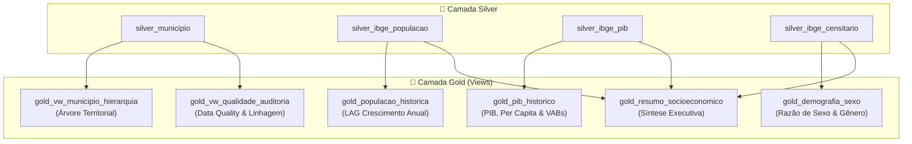

# Modelagem Analítica SQL — Camada Gold (Views e Métricas)

> **Camada do Pipeline**: Gold / Analytical & Consumption
> **Engine**: SQLite (`data/ibge_maua.db`)
> **Implementação**: SQL Views Declarativas (`CREATE VIEW IF NOT EXISTS`)
> **Status**: Homologado e Operacional

---

## 1. Visão Geral e Princípios de Design

A **Camada Gold** representa o nível de consumo analítico da *Medallion Architecture* no projeto **`desafio_IBGE`**.

Implementada inteiramente via **SQL Views** sobre as tabelas normalizadas da camada Silver e metadados da camada Bronze, a camada Gold disponibiliza modelos semânticos prontos para consumo com custo zero de redundância em disco.

### Princípios de Engenharia Adotados:
1. **Zero Redundância Física**: Nenhuma tabela física duplicada; todas as estruturas são computadas sob demanda via views SQL.
2. **Defesa Contra Divisão por Zero**: Aplicação compulsória de `NULLIF(divisor, 0)` em todos os cálculos percentuais e razões estatísticas.
3. **Janelamento com Particionamento Metodológico**: Cálculo de variações anuais (`LAG()`) particionado por tipo de metodologia (`CENSO` vs `ESTIMATIVA`), prevenindo variações espúrias entre bases distintas.
4. **Preservação Temporal Estrita**: Todo indicador consolidado mantém a associação indelével com seu respectivo `ano_referencia` e `fonte_pesquisa`.

---

## 2. Catálogo das 6 Views da Camada Gold



---

## 3. Especificação Detalhada das Views SQL

### 3.1. `gold_vw_municipio_hierarquia` (Territorial)
Consolida a árvore territorial de Mauá integrando a divisão tradicional (1989) e contemporânea (2017):
- **Grão**: 1 linha por município (`municipio_id = 3529401`).
- **Campos**: Códigos e descrições de Município, UF, Macrorregião, Mesorregião, Microrregião, Região Imediata e Região Intermediária, além de `transformed_at`.

### 3.2. `gold_vw_qualidade_auditoria` (Governança & Data Quality)
Cruza as tabelas `bronze_ibge_raw` e `silver_municipio` implementando `FULL OUTER JOIN` via `UNION ALL`:
- **Grão**: 1 linha por entidade cadastral.
- **Métricas**:
  - `status_integracao`: `'CONFORME'`, `'AUSENTE_NA_SILVER'` ou `'AUSENTE_NA_BRONZE'`.
  - `flag_codigo_ibge_valido`: Validação de 7 dígitos (`BETWEEN 1000000 AND 9999999`).
  - `flag_checksum_valido`: Confirmação do tamanho exato de 64 caracteres do hash SHA-256.
  - `flag_http_ok`: Código de resposta igual a 200.
  - `flag_campos_obrigatorios_nulos`: Alerta de nulos em atributos obrigatórios.
  - `flag_consistencia_geografica`: Verificação de coincidência de UF e Região entre divisões de 1989 e 2017.
  - `latencia_processamento_segundos`: Diferença calculada via `julianday`.

### 3.3. `gold_populacao_historica` (Série Histórica Populacional)
Série temporal anual unindo Censo e Estimativas com cálculo de crescimento:
- **Janelamento**:
  ```sql
  LAG(populacao, 1) OVER (
      PARTITION BY municipio_id, tipo_populacao
      ORDER BY ano ASC
  ) AS populacao_ano_anterior
  ```
- **Métricas Derivadas**:
  - `crescimento_absoluto_ano_anterior = populacao - populacao_ano_anterior`
  - `crescimento_percentual_ano_anterior = ROUND(((populacao - populacao_ano_anterior) * 100.0) / NULLIF(populacao_ano_anterior, 0), 2)`
  - `flag_ano_consecutivo`: `1` se `ano - ano_anterior == 1`, `0` caso contrário (alerta de descontinuidade).

### 3.4. `gold_pib_historico` (Série Econômica e Participações Setoriais)
Pivoteamento analítico das séries de Contas Regionais (1999–2023):
- **Rubricas**: PIB a preços correntes (mil R$), PIB per capita (R$), Impostos líquidos e VABs de Agropecuária, Indústria, Serviços e Administração Pública.
- **Participações Calculadas com Proteção `NULLIF`**:
  - `pct_vab_agropecuaria = ROUND((vab_agropecuaria * 100.0) / NULLIF(vab_total, 0), 2)`
  - `pct_vab_industria = ROUND((vab_industria * 100.0) / NULLIF(vab_total, 0), 2)`
  - `pct_vab_servicos = ROUND((vab_servicos * 100.0) / NULLIF(vab_total, 0), 2)`
  - `pct_vab_administracao_publica = ROUND((vab_administracao_publica * 100.0) / NULLIF(vab_total, 0), 2)`

### 3.5. `gold_demografia_sexo` (Estrutura de Gênero do Censo 2022)
Apura a distribuição censitária por sexo e a Razão de Sexo oficial de Mauá:
- **População de Homens**: `201.348` (48,14%)
- **População de Mulheres**: `216.913` (51,86%)
- **Total Censitário**: `418.261` habitantes
- **Razão de Sexo**:
  ```sql
  ROUND((populacao_homens * 100.0) / NULLIF(populacao_mulheres, 0), 2)
  -- Resultado: 92.82 homens por 100 mulheres
  ```

### 3.6. `gold_resumo_socioeconomico` (Síntese Executiva)
Consolida os indicadores mais recentes apurados para Mauá:
1. População Censo 2022: `418.261` habitantes
2. População Estimada 2026: `429.064` habitantes
3. PIB a Preços Correntes (2023): `R$ 25.000.732,02 mil` (~R$ 25 bilhões)
4. PIB per capita (2023): `R$ 59.773,04`
5. Área Territorial Oficial: `61,937 km²`
6. Densidade Demográfica: `6.753,01 hab/km²`
7. Taxa de Alfabetização (15+ anos): `96,74%`
8. População Homens: `201.348`
9. População Mulheres: `216.913`

---

## 4. Consumo Programático em Python / Pandas

O pacote `desafio_ibge.loading.storage` disponibiliza métodos de acesso direto tipados:

```python
from desafio_ibge.loading import (
    read_gold_hierarquia,
    read_gold_auditoria,
    read_gold_populacao_historica,
    read_gold_pib_historico,
    read_gold_demografia_sexo,
    read_gold_resumo_socioeconomico,
    get_kpis_geograficos,
    get_kpis_qualidade,
    get_kpis_socioeconomicos,
)

# 1. Carregar série de população com variações anuais
df_pop = read_gold_populacao_historica(municipio_id=3529401)
print(df_pop[["ano", "populacao", "tipo_populacao", "crescimento_percentual_ano_anterior"]])

# 2. Carregar série econômica de PIB
df_pib = read_gold_pib_historico(municipio_id=3529401)
print(df_pib[["ano", "pib_corrente_mil_reais", "pib_per_capita_reais", "pct_vab_servicos"]])

# 3. Carregar indicadores demográficos e razão de sexo
df_demo = read_gold_demografia_sexo(municipio_id=3529401)
print(f"Razão de Sexo em Mauá: {df_demo['razao_sexo'].iloc[0]} homens / 100 mulheres")

# 4. Carregar KPIs consolidados
kpis = get_kpis_socioeconomicos(municipio_id=3529401)
print(kpis)
```
