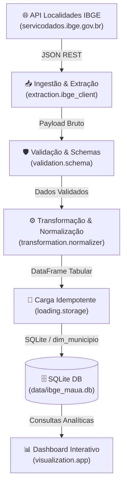

# Desafio IBGE — Engenharia de Dados

> **Pipeline de Engenharia de Dados para análise territorial e cadastral do município de Mauá (SP) utilizando serviços oficiais de dados do IBGE.**

---

## 📌 Visão Geral

O **`desafio_IBGE`** é um projeto profissional de Engenharia de Dados desenvolvido em Python. O pipeline implementa boas práticas de arquitetura de software, ingestão resiliente de APIs REST públicas, normalização tabular com Pandas, governança de qualidade de dados (Data Quality) com Pydantic, armazenamento relacional idempotente em SQLite e visualização analítica com Streamlit.

### 🎯 Objeto de Análise

- **Município**: Mauá
- **Unidade da Federação**: São Paulo (SP) — Código UF `35`
- **Código IBGE**: `3529401`
- **Fonte Primária**: [API de Localidades do IBGE](https://servicodados.ibge.gov.br/api/v1/localidades)

---

## 🏛️ Arquitetura Modular

O projeto adota uma arquitetura em camadas concêntricas sob o diretório `src/desafio_ibge/`, seguindo os princípios de **Responsabilidade Única (SRP)** e **Separação de Preocupações (SoC)**:



### Componentes Principais

| Módulo | Responsabilidade |
| :--- | :--- |
| `desafio_ibge.config` | Centralização de constantes, parâmetros de rede e paths. |
| `desafio_ibge.extraction` | Cliente HTTP com pooling de conexão, timeout e retry backoff. |
| `desafio_ibge.validation` | Contratos de dados com Pydantic e checagem de integridade IBGE. |
| `desafio_ibge.transformation` | Desaninhamento JSON (`json_normalize`) e saneamento de nomes. |
| `desafio_ibge.loading` | DDL e operações de persistência idempotente (`UPSERT`). |
| `desafio_ibge.visualization` | Interface de usuário desacoplada em Streamlit e Plotly. |

---

## 🚀 Guia Rápido de Instalação e Execução

### Pré-requisitos
- **Python**: `>=3.13,<4.0` (gerenciado preferencialmente com **Pyenv**)
- **Poetry**: `>=2.0`

### 1. Clonar e Instalar Dependências
```bash
# Instalar dependências no ambiente virtual gerenciado pelo Poetry
poetry install
```

### 2. Validação e Qualidade de Código
```bash
# Checagem estática com Ruff
poetry run ruff check .

# Formatação de código
poetry run ruff format .

# Suite de testes com cobertura
poetry run pytest
```

### 3. Documentação Técnica
O projeto utiliza **Taskipy** para automação de tarefas cotidianas:

```bash
# Iniciar o servidor local de documentação MkDocs
poetry run task docs

# Validar compilação estrita da documentação (Strict Build)
poetry run task docs-build
```

---

## 📚 Navegação na Documentação

- 📄 **[Documentação da API do IBGE](doc_api.md)**: Especificação detalhada dos endpoints, dicionário de dados dos 22 atributos, exemplo de payload JSON e regras de qualidade.
- 📋 **[Planejamento Técnico (`PLAN.md`)](https://github.com/)**: Cronograma de desenvolvimento incremental por fases.
- 🛡️ **[Diretrizes e Padrões (`SKILL.md`)](https://github.com/)**: Regras mandatórias de engenharia, governança e testes.
