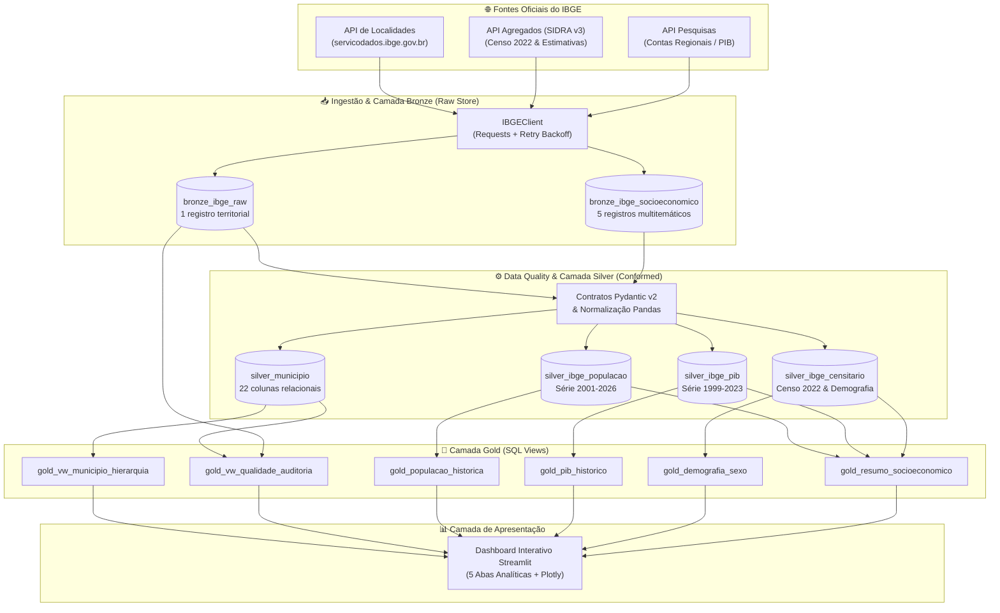

# Desafio IBGE — Engenharia de Dados

> **Pipeline de Engenharia de Dados para análise territorial e socioeconômica do município de Mauá (SP) utilizando serviços oficiais de dados do IBGE.**

---

## 📌 Visão Geral

O **`desafio_IBGE`** é um projeto profissional de Engenharia de Dados desenvolvido em Python 3.13.13. O ecossistema implementa boas práticas de arquitetura de software, ingestão resiliente de APIs REST públicas do IBGE, normalização tabular de séries temporais com Pandas, governança e qualidade de dados (Data Quality) com Pydantic v2, armazenamento relacional idempotente em SQLite sob o padrão **Medallion Architecture (Bronze, Silver e Gold)** e visualização analítica interativa com Streamlit e Plotly Express.

### 🎯 Objeto de Análise

- **Município**: Mauá
- **Unidade da Federação**: São Paulo (SP) — Código UF `35`
- **Código IBGE**: `3529401`
- **Fontes Oficiais**:
  - [API de Localidades do IBGE](https://servicodados.ibge.gov.br/api/v1/localidades) (Malha territorial e hierarquia político-administrativa)
  - [API de Agregados / SIDRA v3](https://servicodados.ibge.gov.br/api/v3/agregados) (Censo Demográfico 2022 e Estimativas Anuais de População)
  - [API de Pesquisas do IBGE](https://servicodados.ibge.gov.br/api/v1/pesquisas) (Contas Regionais — PIB Municipal e PIB per capita)

---

## 🏛️ Arquitetura Medalhão Expandida

O pipeline implementa o padrão Medalhão com separação estrita de responsabilidades sobre o banco relacional local `data/ibge_maua.db`:



### Inventário de Objetos do Banco SQLite (`data/ibge_maua.db`)

| Camada | Objeto | Tipo | Granularidade / Domínio | Registros |
| :--- | :--- | :--- | :--- | :---: |
| **Bronze** | `bronze_ibge_raw` | Tabela | Payload JSON bruto territorial + SHA-256 | 1 |
| **Bronze** | `bronze_ibge_socioeconomico` | Tabela | Payloads brutos de pesquisas e agregados + SHA-256 | 5 |
| **Silver** | `silver_municipio` | Tabela | 22 atributos territoriais normalizados em `snake_case` | 1 |
| **Silver** | `silver_ibge_populacao` | Tabela | Séries temporais de Censo e Estimativas (2001–2026) | 23 |
| **Silver** | `silver_ibge_pib` | Tabela | Séries de PIB, VABs setoriais e impostos (1999–2023) | 227 |
| **Silver** | `silver_ibge_censitario` | Tabela | Variáveis do Censo 2022 (sexo, alfabetização, área, densidade) | 5 |
| **Gold** | `gold_vw_municipio_hierarquia` | View | Consolidação das divisões regionais de 1989 e 2017 | 1 |
| **Gold** | `gold_vw_qualidade_auditoria` | View | Auditoria de conciliação Bronze vs Silver e latência | 1 |
| **Gold** | `gold_populacao_historica` | View | Evolução anual com `LAG()` de variação absoluta e percentual | 23 |
| **Gold** | `gold_pib_historico` | View | Evolução econômica, PIB per capita e participações do VAB | 25 |
| **Gold** | `gold_demografia_sexo` | View | Contagens por sexo, participações e razão de sexo (H/100 M) | 1 |
| **Gold** | `gold_resumo_socioeconomico` | View | Resumo executivo dos indicadores consolidados mais recentes | 9 |

---

## 🧩 Componentes Principais do Pacote `desafio_ibge`

| Módulo | Responsabilidade Técnica |
| :--- | :--- |
| `desafio_ibge.config` | Centralização de constantes de rede, códigos IBGE, nomes de tabelas/views e paths de dados. |
| `desafio_ibge.extraction` | Cliente HTTP resiliente (`IBGEClient`) com pooling de conexões, retries exponenciais e timeouts explícitos. |
| `desafio_ibge.validation` | Contratos estritos Pydantic v2 (`MunicipioSchema`, `PopulacaoSilverSchema`, `PIBSilverSchema`, `CensitarioSilverSchema`). |
| `desafio_ibge.transformation` | Normalizadores Pandas com desaninhamento JSON, achatamento tabular, tipagem forte e saneamento `snake_case`. |
| `desafio_ibge.loading` | Gerenciador de transações SQLite (`db_transaction`), DDLs, UPSERTs idempotentes e consultas às Views Gold. |
| `desafio_ibge.visualization` | Aplicação interativa em Streamlit estruturada em 5 abas analíticas enriquecidas com gráficos Plotly Express. |
| `desafio_ibge.main` | Orquestrador E2E com fail-fast, rastreamento de latência e execução integrada dos fluxos territorial e socioeconômico. |

---

## 🚀 Guia Rápido de Instalação e Execução

### Pré-requisitos
- **Python**: `>=3.13,<4.0` (recomendado: Python `3.13.13` gerenciado via **Pyenv**)
- **Poetry**: `>=2.0`

### 1. Instalar Dependências
```bash
# Instalação completa das dependências de produção e desenvolvimento
poetry install
```

### 2. Executar o Pipeline de Dados Completo (E2E)
```bash
poetry run python -m desafio_ibge.main
# ou via atalho Taskipy:
poetry run task pipeline
```

### 3. Executar o Dashboard Interativo (Streamlit)
```bash
poetry run streamlit run src/desafio_ibge/visualization/app.py
# ou via atalho Taskipy:
poetry run task dashboard
```

### 4. Qualidade de Código e Testes Automatizados
```bash
# Checagem estática com Ruff
poetry run ruff check .

# Formatação de código com Ruff
poetry run ruff format .

# Suite de testes com verificação de cobertura (mínimo 50%)
poetry run task test
```

### 5. Documentação Técnica & CI/CD
```bash
# Servidor de desenvolvimento local com live-reload
poetry run task docs

# Validação estrita da compilação MkDocs (Strict Build)
poetry run task docs-build
```

- **Deploy Automático**: Compilação estrita e publicação contínua no GitHub Pages via GitHub Actions a cada push na branch `main`.
- **Acesso Online**: [https://jonesbastos.github.io/IBGE_MAUA/](https://jonesbastos.github.io/IBGE_MAUA/)

---

## 📚 Navegação na Documentação

- 🏛️ **[Arquitetura Medalhão](architecture.md)**: Fundamentos, diagrama conceitual e especificações completas das camadas Bronze, Silver e Gold.
- 📄 **[Documentação da API do IBGE](doc_api.md)**: Especificação detalhada dos endpoints de Localidades, Agregados (SIDRA v3) e Pesquisas com dicionário de variáveis.
- ⚙️ **[Transformação & Data Quality](transformation.md)**: Contratos Pydantic v2, normalização tabular com Pandas e desaninhamento de séries temporais.
- 💾 **[Armazenamento SQLite (Bronze & Silver)](storage.md)**: DDLs relacionais, UPSERTs idempotentes, controle transacional e inventário físico.
- 🏆 **[Camada Gold & Analytics](gold_analytics.md)**: Views analíticas SQL, janelamento com `LAG()`, divisão segura com `NULLIF()` e KPIs de governança.
- 📊 **[Dashboard Interativo](dashboard.md)**: Interface Streamlit estruturada em 5 abas analíticas com visualizações Plotly Express.
- 🔄 **[Pipeline & Orquestração](pipeline.md)**: Fluxo unificado end-to-end, controle transacional, fail-fast e execução idempotente.
