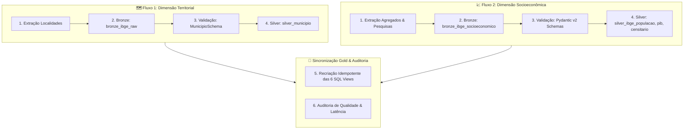

# Orquestração do Pipeline End-to-End

> **Camada do Pipeline**: Orquestração e Integração Contínua
> **Módulo**: `src/desafio_ibge/main.py`
> **Comando de Execução**: `poetry run python -m desafio_ibge.main` ou `poetry run task pipeline`
> **Status**: Homologado e Operacional

---

## 1. Visão Geral do Ciclo de Vida dos Dados

O orquestrador unificado (`src/desafio_ibge/main.py`) coordena a execução ponta a ponta dos dois domínios de dados do projeto: o **fluxo territorial** (API de Localidades) e o **fluxo socioeconômico** (APIs de Agregados e Pesquisas).

---

## 2. Detalhamento Sequencial das Etapas

### Etapa 1: Ingestão e Carga Territorial
1. **Extração**: Consulta ao endpoint oficial de Mauá (`https://servicodados.ibge.gov.br/api/v1/localidades/municipios/3529401`) com política de retry e pooling de conexões.
2. **Bronze**: Persistência do JSON bruto acompanhado do hash SHA-256 na tabela `bronze_ibge_raw` via `UPSERT`.
3. **Data Quality**: Validação estrutural com Pydantic v2 (`MunicipioSchema`).
4. **Silver**: Achatamento com Pandas e carga relacional de 22 colunas em `silver_municipio` via `UPSERT`.

### Etapa 2: Ingestão e Carga Socioeconômica
1. **Extração Paralela**: Consulta a 5 indicadores do IBGE (Censo 2022 básico, série de estimativas populacionais 2001–2026, Contas Regionais de PIB 1999–2023, taxa de alfabetização e demografia por sexo).
2. **Bronze**: Carga atômica de cada payload bruto na tabela `bronze_ibge_socioeconomico` via `UPSERT` por chave composta.
3. **Data Quality & Schemas**: Validação dos registros através de `PopulacaoSilverSchema`, `PIBSilverSchema` e `CensitarioSilverSchema`.
4. **Silver**: Normalização tabular em formato long e carga em `silver_ibge_populacao` (23 registros), `silver_ibge_pib` (227 registros) e `silver_ibge_censitario` (5 registros).

### Etapa 3: Modelagem e Sincronização Gold
- Execução do DDL de recriação idempotente (`CREATE VIEW IF NOT EXISTS`) para as **6 SQL Views**:
  - `gold_vw_municipio_hierarquia`
  - `gold_vw_qualidade_auditoria`
  - `gold_populacao_historica`
  - `gold_pib_historico`
  - `gold_demografia_sexo`
  - `gold_resumo_socioeconomico`

### Etapa 4: Validação Integrada e Auditoria
- Consulta automática a `gold_vw_qualidade_auditoria` para aferir conformidade, contagem total de registros em todas as tabelas e latência média em segundos.

---

## 3. Gestão Transacional e Mecanismo Fail-Fast

- **Transações Atômicas**: As operações de escrita são envelopadas por context managers que asseguram rollback compulsório em caso de exceções imprevistas.
- **Fail-Fast**: Se qualquer etapa pré-requisito falhar (por exemplo, indisponibilidade prolongada da API do IBGE ou payload corrompido que viole os contratos Pydantic), o orquestrador encerra a execução imediatamente com **código de saída `1`**, impedindo que dados inconsistentes alcancem as camadas superiores.
- **Códigos de Retorno (`Exit Codes`)**:
  - `0`: Execução bem-sucedida, todas as camadas sincronizadas com integridade 100%.
  - `1`: Erro operacional ou violação de contrato de dados.

---

## 4. Garantia de Idempotência Comprovada

A execução repetida do pipeline com os mesmos dados de entrada mantém rigorosamente os mesmos volumes de registros e integridade relacional:

| Tabela / Objeto | Rodada 1 | Rodada 2 | Comportamento Relacional |
| :--- | :---: | :---: | :--- |
| `bronze_ibge_raw` | 1 | 1 | `ON CONFLICT(ibge_id) DO UPDATE` |
| `bronze_ibge_socioeconomico` | 5 | 5 | `ON CONFLICT(municipio_id, indicador, periodo_referencia) DO UPDATE` |
| `silver_municipio` | 1 | 1 | `ON CONFLICT(id) DO UPDATE` |
| `silver_ibge_populacao` | 23 | 23 | `ON CONFLICT(municipio_id, ano, tipo_populacao) DO UPDATE` |
| `silver_ibge_pib` | 227 | 227 | `ON CONFLICT(municipio_id, ano, variavel_codigo) DO UPDATE` |
| `silver_ibge_censitario` | 5 | 5 | `ON CONFLICT(municipio_id, variavel_codigo) DO UPDATE` |
| **Total de Registros Físicos** | **322** | **322** | **Zero duplicação garantida** |
