# Orquestração do Pipeline End-to-End

O pipeline de dados do projeto **`desafio_IBGE`** implementa um fluxo integrado de Engenharia de Dados orientado à **Arquitetura Medalhão (Medallion Architecture)**, garantindo ingestão resiliente, integridade referencial, validação rigorosa de schemas e publicação analítica de alto desempenho sobre o banco relacional local **SQLite**.

---

## 1. Visão Geral do Ciclo de Vida dos Dados

O pipeline transita os dados por cinco etapas coordenadas:

```mermaid
flowchart LR
    A["🌐 IBGE API<br>(Endpoint Mauá 3529401)"] -->|Requests + Retries| B["1. Extração<br>(ibge_client)"]
    B -->|Payload JSON Bruto| C["2. Camada Bronze<br>(bronze_ibge_raw)"]
    C -->|Validação de Schema| D["3. Data Quality<br>(Pydantic v2)"]
    D -->|Achatamento Tabular| E["4. Transformação<br>(Pandas snake_case)"]
    E -->|Carga Idempotente| F["5. Camada Silver<br>(silver_municipio)"]
    F -->|Modelagem SQL Views| G["6. Camada Gold<br>(gold_vw_*)"]
    G -->|Leituras Analíticas| H["📊 Dashboard Streamlit<br>& Relatórios"]
```



---

## 2. Detalhamento das Etapas do Fluxo

### Etapa 1: Extração Resiliente (`extraction/ibge_client.py`)
- **Origem Oficial**: `https://servicodados.ibge.gov.br/api/v1/localidades/municipios/3529401`
- **Mecanismos de Resiliência**:
  - Pool de conexões HTTP via `requests.Session`.
  - Configuração de `urllib3.util.Retry` com backoff exponencial (3 tentativas em códigos 429, 500, 502, 503 e 504).
  - Timeout explícito configurado em tupla: `(3.05, 10.0)` segundos (conexão e leitura).
  - Verificação estrita de cabeçalho `Content-Type: application/json` e código HTTP 200.

### Etapa 2: Ingestão na Camada Bronze (`loading/storage.py`)
- **Tabela**: `bronze_ibge_raw`
- **Preservação Bruta**: O JSON retornado pela API é armazenado integralmente como string de texto (`payload_json`), sem qualquer modificação ou perda de nós aninhados.
- **Auditoria & Metadados**:
  - `ibge_id`: Chave primária (3529401).
  - `endpoint_url`: URL exata consultada.
  - `ingestion_timestamp`: Carimbo de data/hora em UTC no padrão ISO-8601.
  - `http_status`: Código de resposta retornado pela requisição.
  - `checksum_sha256`: Hash criptográfico SHA-256 do payload, permitindo aferição matemática de integridade e detecção de mutações nos dados da fonte.
- **Idempotência**: `INSERT ... ON CONFLICT(ibge_id) DO UPDATE SET ...` assegura que reexecuções atualizem o registro sem duplicações.

### Etapa 3: Governança & Validação de Schema (`validation/schema.py`)
- **Validador**: Pydantic v2 (`MunicipioSchema`).
- **Regras Mandatórias**:
  - Código IBGE com exatamente 7 dígitos e dentro da faixa válida do Brasil (`1000000` a `9999999`).
  - Código UF igual a `35` e sigla correspondente a `"SP"`.
  - Nomes e descrições não vazios (`min_length=1`, sem apenas espaços em branco).
  - Presença compulsória de todos os nós aninhados (`microrregiao`, `mesorregiao`, `regiao-imediata`, `regiao-intermediaria`).
- **Interrupção Defensiva**: Qualquer payload divergente interrompe a promoção para a camada Silver, lançando `ValidationError` e evitando poluição da base higienizada.

### Etapa 4: Normalização Tabular (`transformation/normalizer.py`)
- **Processador**: Pandas (`json_to_dataframe`).
- **Achatamento (Flattening)**:
  - Expansão de dicionários aninhados em formato colunar tabular.
  - Sanitização de cabeçalhos: substituição de hífens (`-`) e pontos (`.`) por sublinhados (`_`), garantindo nomes 100% aderentes à convenção `snake_case`.
  - Produção de **22 colunas relacionais**, incluindo atributos das divisões de 1989 e 2017.

### Etapa 5: Persistência na Camada Silver (`loading/storage.py`)
- **Tabela**: `silver_municipio`
- **Tipagem Estrita**: 22 colunas relacionais com tipos SQLite (`INTEGER` e `TEXT`) e restrições `NOT NULL`.
- **Rastreabilidade**: Adição da coluna `transformed_at` contendo o timestamp UTC da transformação.
- **Idempotência Relacional**: Operação de UPSERT atômico (`INSERT ... ON CONFLICT(id) DO UPDATE SET ...`), garantindo unicidade por município (`COUNT(*) == 1`).

### Etapa 6: Camada Gold & Consumo Analítico (`loading/storage.py`)
- **Views SQLite**:
  - `gold_vw_municipio_hierarquia`: Visão analítica com nomes de colunas unificados para consumo por relatórios e dashboards.
  - `gold_vw_qualidade_auditoria`: View de governança que cruza Bronze e Silver com semântica de `FULL OUTER JOIN`, computando taxas de conformidade, latência de processamento em segundos e sinalização de registros órfãos.

---

## 3. Gestão de Transações e Tratamento de Falhas

Toda a interação com o SQLite ocorre sob um gerenciador de contexto transacional seguro:

```python
with db_transaction(db_path) as conn:
    conn.execute(...)
    # Commit automático ao término com sucesso
```

- **Rollback Automático**: Caso qualquer comando SQL ou operação em lote falhe, uma cláusula `conn.rollback()` é imediatamente disparada, impedindo estados parciais ou corrupção no banco.
- **Configurações Pragma de Produção**:
  - `PRAGMA foreign_keys = ON;`: Ativação de integridade referencial.
  - `PRAGMA journal_mode = WAL;`: Write-Ahead Logging para permitir leituras concorrentes sem bloqueio de escrita.
  - `PRAGMA busy_timeout = 5000;`: Tolerância a concorrência de I/O em disco.

---

## 4. Idempotência e Rastreabilidade

O pipeline garante execução **100% idempotente**:

| Cenário de Execução | Comportamento na Bronze | Comportamento na Silver | Impacto na Gold |
| :--- | :--- | :--- | :--- |
| **Primeira Carga** | Registro inserido com hash e timestamp UTC | Registro inserido com 22 colunas e `transformed_at` | Views retornam 1 registro conforme |
| **Recarga Sem Alteração** | Registro atualizado in-place (`ON CONFLICT`) com novo timestamp | Registro atualizado in-place (`ON CONFLICT`) com novo timestamp | Views continuam retornando 1 registro com contagem inalterada |
| **Recarga com Nova Versão** | Hash e payload atualizados atomicamente | Colunas relacionais atualizadas | Views refletem a alteração imediatamente |

---

## 5. Orquestrador Unificado (`main.py`)

A consolidação de todas as etapas em um ponto de entrada único (`src/desafio_ibge/main.py`) orquestra o fluxo de ponta a ponta com controle de falha (fail-fast), logging e códigos de saída:

```powershell
poetry run python -m desafio_ibge.main
# ou via atalho Taskipy:
poetry run task pipeline
```

### Comportamento dos Códigos de Retorno (`Exit Codes`)
- **`0`**: Pipeline concluído com 100% de conformidade e integridade.
- **`1`**: Falha detectada em qualquer etapa obrigatória (interrupção imediata, sem propagação de erro para as camadas subsequentes).
