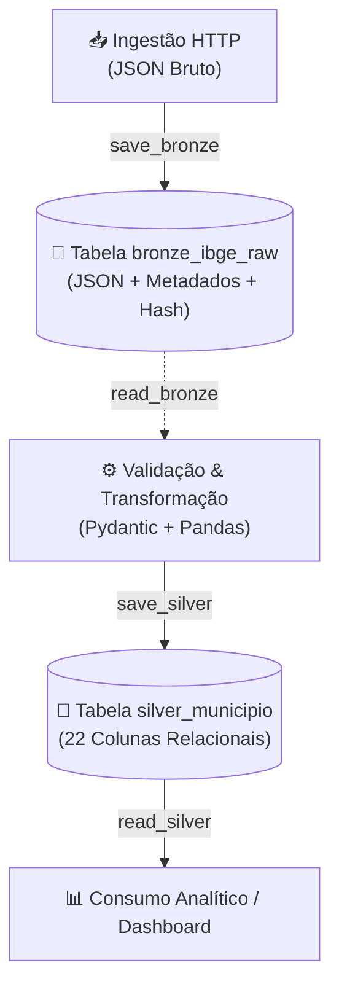

# Armazenamento Relacional: Camadas Bronze e Silver (SQLite)

> **Módulo do Pipeline**: `desafio_ibge.loading.storage`
> **Banco de Dados**: SQLite local (`data/ibge_maua.db`)
> **Status**: Homologado

---

## 1. Visão Geral e Responsabilidades

O módulo `desafio_ibge.loading.storage` gerencia a persistência relacional do pipeline sob a **Medallion Architecture**, garantindo consistência transacional, rastreabilidade e idempotência estrita sem dependências de ORMs pesados.



---

## 2. Estrutura SQL das Tabelas (DDL)

### 2.1. Camada Bronze (`bronze_ibge_raw`)
Preserva o JSON original retornado pelo IBGE acompanhado de metadados de auditoria:

```sql
CREATE TABLE IF NOT EXISTS bronze_ibge_raw (
    ibge_id INTEGER PRIMARY KEY,
    endpoint_url TEXT NOT NULL,
    payload_json TEXT NOT NULL,
    ingestion_timestamp TEXT NOT NULL,
    http_status INTEGER NOT NULL,
    checksum_sha256 TEXT NOT NULL
);
```

#### Dicionário de Campos Bronze:
| Campo | Tipo SQL | Restrição | Descrição |
| :--- | :--- | :--- | :--- |
| `ibge_id` | `INTEGER` | `PRIMARY KEY` | Código numérico de 7 dígitos do município (`3529401`). |
| `endpoint_url` | `TEXT` | `NOT NULL` | URL oficial consultada no IBGE. |
| `payload_json` | `TEXT` | `NOT NULL` | JSON bruto original completo em UTF-8 com chaves ordenadas. |
| `ingestion_timestamp` | `TEXT` | `NOT NULL` | Carimbo de data/hora UTC no formato ISO 8601. |
| `http_status` | `INTEGER` | `NOT NULL` | Código de resposta HTTP (ex.: 200). |
| `checksum_sha256` | `TEXT` | `NOT NULL` | Hash SHA-256 de 64 caracteres hexadecimais para auditoria. |

---

### 2.2. Camada Silver (`silver_municipio`)
Armazena as 22 variáveis relacionais normalizadas em `snake_case`, validadas e tipadas:

```sql
CREATE TABLE IF NOT EXISTS silver_municipio (
    id INTEGER PRIMARY KEY,
    nome TEXT NOT NULL,
    microrregiao_id INTEGER NOT NULL,
    microrregiao_nome TEXT NOT NULL,
    microrregiao_mesorregiao_id INTEGER NOT NULL,
    microrregiao_mesorregiao_nome TEXT NOT NULL,
    microrregiao_mesorregiao_uf_id INTEGER NOT NULL,
    microrregiao_mesorregiao_uf_sigla TEXT NOT NULL,
    microrregiao_mesorregiao_uf_nome TEXT NOT NULL,
    microrregiao_mesorregiao_uf_regiao_id INTEGER NOT NULL,
    microrregiao_mesorregiao_uf_regiao_sigla TEXT NOT NULL,
    microrregiao_mesorregiao_uf_regiao_nome TEXT NOT NULL,
    regiao_imediata_id INTEGER NOT NULL,
    regiao_imediata_nome TEXT NOT NULL,
    regiao_imediata_regiao_intermediaria_id INTEGER NOT NULL,
    regiao_imediata_regiao_intermediaria_nome TEXT NOT NULL,
    regiao_imediata_regiao_intermediaria_uf_id INTEGER NOT NULL,
    regiao_imediata_regiao_intermediaria_uf_sigla TEXT NOT NULL,
    regiao_imediata_regiao_intermediaria_uf_nome TEXT NOT NULL,
    regiao_imediata_regiao_intermediaria_uf_regiao_id INTEGER NOT NULL,
    regiao_imediata_regiao_intermediaria_uf_regiao_sigla TEXT NOT NULL,
    regiao_imediata_regiao_intermediaria_uf_regiao_nome TEXT NOT NULL,
    transformed_at TEXT NOT NULL
);
```

---

## 3. Estratégia de UPSERT e Idempotência

Para garantir que reexecuções sucessivas do pipeline não gerem duplicações ou erros de chave primária, são utilizadas cláusulas nativas de `UPSERT` do SQLite:

### Bronze UPSERT:
```sql
INSERT INTO bronze_ibge_raw (
    ibge_id, endpoint_url, payload_json, ingestion_timestamp, http_status, checksum_sha256
) VALUES (?, ?, ?, ?, ?, ?)
ON CONFLICT(ibge_id) DO UPDATE SET
    endpoint_url = excluded.endpoint_url,
    payload_json = excluded.payload_json,
    ingestion_timestamp = excluded.ingestion_timestamp,
    http_status = excluded.http_status,
    checksum_sha256 = excluded.checksum_sha256;
```

### Silver UPSERT:
```sql
INSERT INTO silver_municipio (id, nome, ..., transformed_at)
VALUES (?, ?, ..., ?)
ON CONFLICT(id) DO UPDATE SET
    nome = excluded.nome,
    microrregiao_id = excluded.microrregiao_id,
    ...
    transformed_at = excluded.transformed_at;
```

---

## 4. Instruções de Inicialização e Utilização

### 4.1. Exemplo de Código em Python:
```python
from desafio_ibge.extraction.ibge_client import get_municipio_maua, IBGEClient
from desafio_ibge.transformation.normalizer import json_to_dataframe
from desafio_ibge.loading.storage import (
    init_db,
    save_bronze,
    save_silver,
    read_bronze,
    read_silver,
)

# 1. Inicializa o banco de dados (cria tabelas se não existirem)
init_db()

# 2. Extrai dados da API oficial
raw_payload = get_municipio_maua()
endpoint = "https://servicodados.ibge.gov.br/api/v1/localidades/municipios/3529401"

# 3. Persiste na Camada Bronze (imutabilidade e linhagem)
checksum = save_bronze(raw_payload, endpoint_url=endpoint)
print(f"Bronze salvo com hash SHA-256: {checksum[:8]}...")

# 4. Transforma e valida
df_silver = json_to_dataframe(raw_payload)

# 5. Persiste na Camada Silver (dados relacionais conformed)
rows = save_silver(df_silver)
print(f"Silver salva com {rows} registro(s).")

# 6. Consultas
df_consultado = read_silver(3529401)
print(df_consultado[["id", "nome", "microrregiao_nome", "microrregiao_mesorregiao_uf_sigla"]])
```

---

## 5. Exemplos de Consultas SQL Úteis

### 5.1. Verificação de Auditoria na Bronze
```sql
SELECT
    ibge_id,
    endpoint_url,
    ingestion_timestamp,
    http_status,
    substr(checksum_sha256, 1, 16) AS hash_curto,
    length(payload_json) AS tamanho_bytes
FROM bronze_ibge_raw;
```

### 5.2. Consulta Consolidada na Silver
```sql
SELECT
    id AS codigo_ibge,
    nome AS municipio,
    microrregiao_nome AS microrregiao,
    microrregiao_mesorregiao_nome AS mesorregiao,
    regiao_imediata_nome AS regiao_imediata,
    microrregiao_mesorregiao_uf_sigla AS uf,
    transformed_at
FROM silver_municipio
WHERE id = 3529401;
```

### 5.3. Comparativo de Frescor (Linhagem Bronze $\leftrightarrow$ Silver)
```sql
SELECT
    b.ibge_id,
    s.nome,
    b.ingestion_timestamp AS ingerido_em,
    s.transformed_at AS tratado_em,
    b.checksum_sha256
FROM bronze_ibge_raw b
JOIN silver_municipio s ON b.ibge_id = s.id;
```
