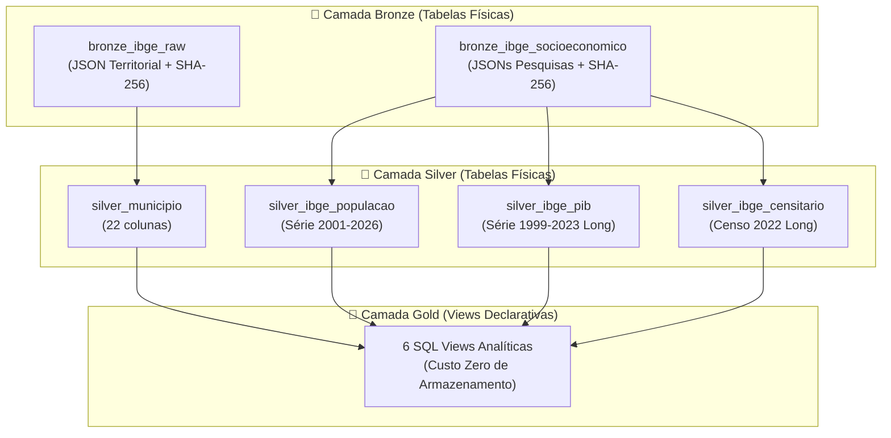

# Armazenamento Relacional: Camadas Bronze e Silver (SQLite)

> **Módulo do Pipeline**: `desafio_ibge.loading.storage`
> **Banco de Dados**: SQLite local (`data/ibge_maua.db`)
> **Status**: Homologado e Operacional

---

## 1. Visão Geral e Responsabilidades

O módulo `desafio_ibge.loading.storage` gerencia a camada de persistência relacional do pipeline sob a **Medallion Architecture**, garantindo consistência transacional ACID, rastreabilidade, imutabilidade da camada bruta e idempotência estrita sem sobrecarga de ORMs pesados.



---

## 2. Estrutura SQL das Tabelas (DDL)

### 2.1. Camada Bronze

#### 1. `bronze_ibge_raw` (Territorial)
Armazena a resposta bruta do endpoint de Localidades:
```sql
CREATE TABLE IF NOT EXISTS bronze_ibge_raw (
    ibge_id INTEGER PRIMARY KEY,
    endpoint_url TEXT NOT NULL,
    payload_json TEXT NOT NULL,
    ingestion_timestamp TEXT NOT NULL,
    http_status INTEGER NOT NULL,
    checksum_sha256 TEXT NOT NULL
);
```

#### 2. `bronze_ibge_socioeconomico` (Socioeconômico)
Armazena as respostas brutas dos agregados e pesquisas do IBGE com chave primária composta:
```sql
CREATE TABLE IF NOT EXISTS bronze_ibge_socioeconomico (
    municipio_id INTEGER NOT NULL,
    indicador TEXT NOT NULL,
    periodo_referencia TEXT NOT NULL,
    endpoint_url TEXT NOT NULL,
    payload_json TEXT NOT NULL,
    ingestion_timestamp TEXT NOT NULL,
    http_status INTEGER NOT NULL,
    checksum_sha256 TEXT NOT NULL,
    PRIMARY KEY (municipio_id, indicador, periodo_referencia)
);
```

---

### 2.2. Camada Silver

#### 1. `silver_municipio` (Territorial)
Armazena a entidade canônica municipal achatada em 22 atributos relacionais:
```sql
CREATE TABLE IF NOT EXISTS silver_municipio (
    id INTEGER PRIMARY KEY,
    nome TEXT NOT NULL,
    microrregiao_id INTEGER NOT NULL,
    microrregiao_nome TEXT NOT NULL,
    microrregiao_mesorregiao_id INTEGER NOT NULL,
    microrregiao_mesorregiao_nome TEXT NOT NULL,
    microrregiao_mesorregiao_uf_id INTEGER NOT NULL,
    microrregiao_mesorregiao_uf_sigla TEXT NOT NULL,
    microrregiao_mesorregiao_uf_nome TEXT NOT NULL,
    microrregiao_mesorregiao_uf_regiao_id INTEGER NOT NULL,
    microrregiao_mesorregiao_uf_regiao_sigla TEXT NOT NULL,
    microrregiao_mesorregiao_uf_regiao_nome TEXT NOT NULL,
    regiao_imediata_id INTEGER NOT NULL,
    regiao_imediata_nome TEXT NOT NULL,
    regiao_imediata_regiao_intermediaria_id INTEGER NOT NULL,
    regiao_imediata_regiao_intermediaria_nome TEXT NOT NULL,
    regiao_imediata_regiao_intermediaria_uf_id INTEGER NOT NULL,
    regiao_imediata_regiao_intermediaria_uf_sigla TEXT NOT NULL,
    regiao_imediata_regiao_intermediaria_uf_nome TEXT NOT NULL,
    regiao_imediata_regiao_intermediaria_uf_regiao_id INTEGER NOT NULL,
    regiao_imediata_regiao_intermediaria_uf_regiao_sigla TEXT NOT NULL,
    regiao_imediata_regiao_intermediaria_uf_regiao_nome TEXT NOT NULL,
    transformed_at TEXT NOT NULL
);
```

#### 2. `silver_ibge_populacao` (Série Histórica de População)
Armazena as contagens censitárias e estimativas anuais:
```sql
CREATE TABLE IF NOT EXISTS silver_ibge_populacao (
    municipio_id INTEGER NOT NULL,
    ano INTEGER NOT NULL,
    populacao INTEGER NOT NULL,
    tipo_populacao TEXT NOT NULL,
    unidade_medida TEXT NOT NULL,
    fonte_pesquisa TEXT NOT NULL,
    transformed_at TEXT NOT NULL,
    PRIMARY KEY (municipio_id, ano, tipo_populacao)
);
```

#### 3. `silver_ibge_pib` (Série Econômica / Contas Regionais)
Armazena rubricas de PIB, VABs e impostos em modelo tabular long:
```sql
CREATE TABLE IF NOT EXISTS silver_ibge_pib (
    municipio_id INTEGER NOT NULL,
    ano INTEGER NOT NULL,
    variavel_codigo INTEGER NOT NULL,
    variavel_nome TEXT NOT NULL,
    valor REAL NOT NULL,
    unidade_medida TEXT NOT NULL,
    fonte_pesquisa TEXT NOT NULL,
    transformed_at TEXT NOT NULL,
    PRIMARY KEY (municipio_id, ano, variavel_codigo)
);
```

#### 4. `silver_ibge_censitario` (Indicadores Censitários 2022)
Armazena variáveis do Censo Demográfico:
```sql
CREATE TABLE IF NOT EXISTS silver_ibge_censitario (
    municipio_id INTEGER NOT NULL,
    ano INTEGER NOT NULL,
    variavel_codigo INTEGER NOT NULL,
    variavel_nome TEXT NOT NULL,
    valor REAL NOT NULL,
    unidade_medida TEXT NOT NULL,
    fonte_pesquisa TEXT NOT NULL,
    categoria TEXT,
    transformed_at TEXT NOT NULL,
    PRIMARY KEY (municipio_id, variavel_codigo)
);
```

---

## 3. Estratégia de UPSERT e Idempotência Estrita

Para garantir que reexecuções sucessivas do pipeline não gerem duplicações ou falhas de chave primária, são utilizadas cláusulas nativas de `UPSERT` (`INSERT ... ON CONFLICT DO UPDATE SET`):

- **Tabelas com Chave Simples** (`bronze_ibge_raw`, `silver_municipio`, `silver_ibge_censitario`):
  Atualizam os campos de carga e os carimbos de auditoria (`ingestion_timestamp` ou `transformed_at`).
- **Tabelas com Chave Composta** (`bronze_ibge_socioeconomico`, `silver_ibge_populacao`, `silver_ibge_pib`):
  Identificam precisamente a tupla única `(municipio_id, ano, variavel_codigo)` ou `(municipio_id, indicador, periodo_referencia)`, garantindo que atualizações anuais ocorram in-place.

---

## 4. Gestão Transacional e Robustez de I/O

O acesso ao banco ocorre sob o gerenciador transacional `db_transaction`:
```python
@contextmanager
def db_transaction(db_path: Path | str = DB_PATH):
    conn = sqlite3.connect(str(db_path), timeout=10.0)
    conn.execute("PRAGMA foreign_keys = ON;")
    conn.execute("PRAGMA journal_mode = WAL;")
    conn.execute("PRAGMA busy_timeout = 5000;")
    try:
        yield conn
        conn.commit()
    except Exception:
        conn.rollback()
        raise
    finally:
        conn.close()
```

- **Rollback Imediato**: Previne gravação parcial em caso de falha em qualquer lote.
- **Modo WAL (Write-Ahead Logging)**: Permite leituras concorrentes simultâneas pelo Streamlit durante a execução de processos de escrita.
- **Busy Timeout**: Espera ativa de até 5000 ms para concorrência de I/O em disco.

---

## 5. Funções Utilitárias e Catálogo de Objetos

O módulo disponibiliza funções de alto nível para persistência e auditoria:

- `save_bronze_socioeconomico(municipio_id, indicador, periodo, endpoint, payload)`
- `save_silver_populacao(df, db_path)`
- `save_silver_pib(df, db_path)`
- `save_silver_censitario(df, db_path)`
- `get_volumetria_medallion(db_path)`: Retorna contagem real segregando tabelas por camada e domínio (Territorial vs Socioeconômico).
- `get_metadados_governanca(db_path)`: Retorna metadados de governança consolidados, incluindo lista de tabelas, status de auditoria e métricas de cobertura.
- `CATALOGO_OBJETOS_MEDALLION`: Dicionário constante contendo a taxonomia e descrição formal de cada objeto gerenciado.
