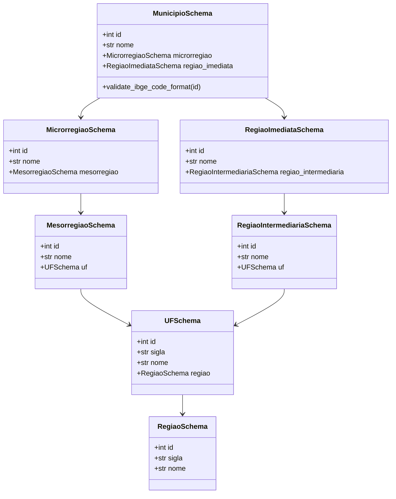

# Transformação, Achatamento e Data Quality

> **Camada do Pipeline**: Silver / Staging
> **Módulos**: `desafio_ibge.validation.schema` & `desafio_ibge.transformation.normalizer`
> **Tecnologias**: Pydantic v2, Pandas, Python Typing

---

## 1. Visão Geral

O estágio de **Transformação e Qualidade de Dados (Data Quality)** atua na transição entre o armazenamento bruto da camada Bronze e a estruturação relacional tipada da camada Silver. Suas responsabilidades centrais são:

1. **Validação Estrita de Contrato (Data Contracts)** com Pydantic v2, garantindo conformidade estrutural, tipos de dados primitivos, restrições numéricas e intervalos canônicos antes de qualquer operação de gravação.
2. **Achatamento Tabular (Flattening)** de estruturas JSON aninhadas via `pandas.json_normalize` e loops determinísticos de extração de séries temporais.
3. **Saneamento de Nomenclatura**: Substituição de hífens (`-`) e pontos (`.`) por sublinhados (`_`) no padrão `snake_case`, assegurando compatibilidade relacional com SQL e dialetos analíticos.
4. **Coerção Explícita de Tipos (Schema Enforcement)**: Conversão garantida de inteiros (`int64`), pontos flutuantes (`float64`) e textos (`string`).
5. **Prevenção de Imputação Espúria**: Dados faltantes ou não divulgados pelo IBGE são preservados como `NULL` / `None`, sendo estritamente proibida a substituição indiscriminada por zeros.

---

## 2. Contratos de Dados com Pydantic v2

### 2.1. Domínio Territorial: `MunicipioSchema`

Valida a resposta do endpoint de Localidades do IBGE e sua estrutura hierárquica completa:



### 2.2. Domínios Socioeconômicos: Schemas Silver

Para as séries temporais e variáveis censitárias, são aplicados três contratos dedicados:

#### 1. `PopulacaoSilverSchema`
Valida as séries temporais populacionais (Censo e Estimativas anuais):
- `municipio_id`: Código IBGE de 7 dígitos (`1000000` a `9999999`).
- `ano`: Ano de referência (`1900` a `2100`).
- `populacao`: Habitantes como inteiro estritamente positivo ($> 0$).
- `tipo_populacao`: Enumeração textual (`"CENSO"` ou `"ESTIMATIVA"`).
- `unidade_medida`: Texto não vazio (padrão `"Pessoas"`).
- `fonte_pesquisa`: Identificador da pesquisa IBGE.
- `transformed_at`: Timestamp UTC em formato ISO-8601.

#### 2. `PIBSilverSchema`
Valida o modelo econômico long de PIB e Contas Regionais:
- `municipio_id`: Código IBGE (`3529401`).
- `ano`: Ano de referência econômico (`1999` a `2023`).
- `variavel_codigo`: Identificador numérico da variável na pesquisa IBGE.
- `variavel_nome`: Descrição em texto da rubrica econômica.
- `valor`: Número real finito (`float`, sem valores infinitos ou NaN).
- `unidade_medida`: Ex.: `"Mil Reais"` ou `"Reais"`.
- `fonte_pesquisa`: Ex.: `"Pesquisa 38 - PIB dos Municípios"`.
- `transformed_at`: Timestamp UTC.

#### 3. `CensitarioSilverSchema`
Valida os indicadores demográficos e censitários estruturais:
- `municipio_id`: Código IBGE (`3529401`).
- `ano`: Ano do Censo (`2022`).
- `variavel_codigo`: Identificador numérico do agregado do SIDRA.
- `variavel_nome`: Nome do indicador (ex.: `"Taxa de alfabetização"`).
- `valor`: Valor numérico real estritamente válido.
- `unidade_medida`: `"%"`, `"km²"`, `"hab/km²"` ou `"Pessoas"`.
- `categoria`: Rótulo de classificação (ex.: `"Geral"`, `"Homens"`, `"Mulheres"`).
- `fonte_pesquisa`: Ex.: `"Censo Demográfico 2022 - Agregado 9543"`.
- `transformed_at`: Timestamp UTC.

---

## 3. Módulos de Normalização Tabular (Pandas)

O módulo `desafio_ibge.transformation.normalizer` implementa as funções puras de conversão e estruturação tabular:

### 3.1. Normalização Territorial: `json_to_dataframe`
- **Entrada**: Payload JSON bruto retornado por `get_municipio_maua`.
- **Ação**: Utiliza `pd.json_normalize` com separador `_`, sanitiza aliases com hífens e produz **1 linha $\times$ 22 colunas** perfeitamente aderentes a `silver_municipio`.

### 3.2. Normalização de População: `transform_bronze_populacao`
- **Entrada**: Payloads brutos de `censo_pop_area_densidade` e `populacao_estimada_historica`.
- **Ação**:
  1. Extrai a contagem oficial do Censo 2022 (418.261 habitantes com `tipo_populacao = "CENSO"`).
  2. Itera sobre a série do Agregado 6579 (2001 a 2026) extraindo estimativas anuais com `tipo_populacao = "ESTIMATIVA"`.
  3. Valida linha a linha com `PopulacaoSilverSchema`.
  4. Retorna DataFrame com **23 registros ordenados**.

### 3.3. Normalização de PIB: `transform_bronze_pib`
- **Entrada**: Payload bruto de `pib_municipal_historico` (Pesquisa 38).
- **Ação**:
  1. Varre o nó de resultados contendo séries históricas de 1999 a 2023.
  2. Mapeia variáveis de PIB total, PIB per capita, impostos líquidos e VABs (Agropecuária, Indústria, Serviços e Administração Pública).
  3. Converte valores em formato numérico e valida com `PIBSilverSchema`.
  4. Retorna DataFrame no formato long com **227 registros**.

### 3.4. Normalização Censitária: `transform_bronze_censitario`
- **Entrada**: Payloads brutos de alfabetização, área, densidade e contagem por sexo.
- **Ação**:
  1. Extrai área territorial oficial (61,937 km²) e densidade (6.753,01 hab/km²).
  2. Extrai taxa de alfabetização da população de 15 anos ou mais (96,74%).
  3. Extrai contagem por sexo (201.348 homens e 216.913 mulheres).
  4. Valida com `CensitarioSilverSchema` e retorna DataFrame com **5 registros**.

### 3.5. Orquestrador Socioeconômico: `transform_socioeconomico_from_bronze`
- Função de conveniência que recebe a conexão SQLite (ou lê de `bronze_ibge_socioeconomico`), dispara as três transformações em paralelo e retorna uma tupla com os três DataFrames validados:
  ```python
  df_pop, df_pib, df_cens = transform_socioeconomico_from_bronze(db_path)
  ```

---

## 4. Garantias de Qualidade e Auditoria de Dados

| Regra de Qualidade | Mecanismo | Comportamento em Caso de Falha |
| :--- | :--- | :--- |
| **Código IBGE Inválido** | Validador Pydantic `@field_validator("id")` | Lança `ValidationError` imediato interrompendo a ingestão. |
| **Valores Finitos** | Validador `math.isnan(v) or math.isinf(v)` | Rejeita registro na validação de schema Silver. |
| **Integridade de Tipos** | Coerção explícita no Pandas (`astype`) | Converte com segurança ou lança `ValueError`. |
| **Nomes de Colunas** | Sanitização regex `[.-] \rightarrow _` | Garante nomes SQL válidos em minúsculas. |
| **Carimbo de Tempo** | Inserção de `transformed_at` (UTC) | Rastreabilidade milimétrica entre camadas Bronze e Silver. |
