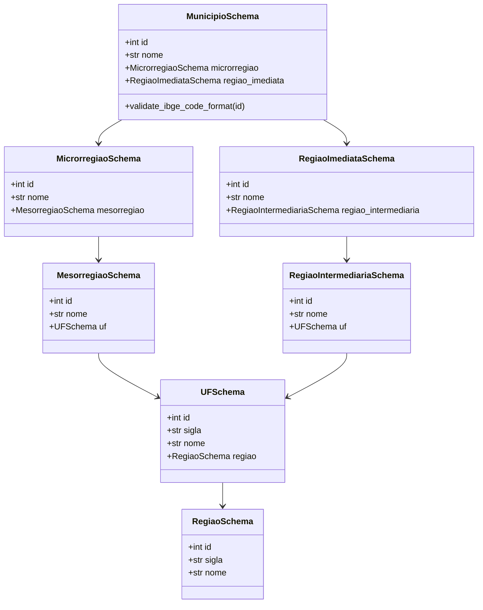

# Transformação, Achatamento e Data Quality

> **Camada do Pipeline**: Silver / Staging
> **Módulos**: `desafio_ibge.validation.schema` & `desafio_ibge.transformation.normalizer`
> **Tecnologias**: Pydantic v2, Pandas, Python Typing

---

## 1. Visão Geral

O estágio de **Transformação e Qualidade de Dados** atua entre a extração bruta dos dados da API do IBGE (camada Bronze) e a persistência relacional em banco SQL (camada Silver). Suas responsabilidades são:

1. **Validação Estrita de Contrato (Data Contract)** com Pydantic v2, garantindo que o JSON do IBGE atenda a todos os tipos, formatos de chave primária e nós obrigatórios antes de qualquer manipulação.
2. **Achatamento Tabular (Flattening)** das 4 ramificações hierárquicas aninhadas utilizando `pandas.json_normalize(..., sep="_")`.
3. **Saneamento de Nomenclatura**: Conversão mandatória de chaves com hífens (ex.: `regiao-imediata` $\rightarrow$ `regiao_imediata`) para o padrão `snake_case` em minúsculas, prevenindo incompatibilidades de sintaxe em bancos relacionais e consultas SQL.
4. **Coerção Explícita de Tipos (Schema Enforcement)** para garantir integridade e compatibilidade colunar.
5. **Imutabilidade**: O payload de entrada original nunca é mutado durante o processamento.

---

## 2. Contrato de Dados com Pydantic v2

O módulo `desafio_ibge.validation.schema` implementa a hierarquia formal dos modelos de validação:



### Regras de Validação Aplicadas:
- **Código IBGE de 7 Dígitos**: O atributo `id` é validado via `@field_validator("id")` para assegurar exatamente 7 caracteres numéricos inteiros.
- **Aliases para Chaves com Hífen**: As chaves `regiao-imediata` e `regiao-intermediaria` são mapeadas via `Field(..., alias="regiao-imediata")` e `ConfigDict(populate_by_name=True)`.
- **Validação de Mauá**: A função `validate_maua_payload(data)` valida que o código municipal seja exatamente `3529401`.

---

## 3. Exemplo Prático de Transformação

### 3.1. Entrada: Payload JSON Bruto do IBGE
```json
{
  "id": 3529401,
  "nome": "Mauá",
  "microrregiao": {
    "id": 35061,
    "nome": "São Paulo",
    "mesorregiao": {
      "id": 3515,
      "nome": "Metropolitana de São Paulo",
      "UF": {
        "id": 35,
        "sigla": "SP",
        "nome": "São Paulo",
        "regiao": {
          "id": 3,
          "sigla": "SE",
          "nome": "Sudeste"
        }
      }
    }
  },
  "regiao-imediata": {
    "id": 350001,
    "nome": "São Paulo",
    "regiao-intermediaria": {
      "id": 3501,
      "nome": "São Paulo",
      "UF": {
        "id": 35,
        "sigla": "SP",
        "nome": "São Paulo",
        "regiao": {
          "id": 3,
          "sigla": "SE",
          "nome": "Sudeste"
        }
      }
    }
  }
}
```

### 3.2. Saída: DataFrame Tabular Normalizado (1 Linha × 22 Colunas)

Ao processar via `json_to_dataframe(maua_raw_payload)`, obtém-se o modelo analítico estruturado:

| Coluna Normalizada | Tipo Pandas | Exemplo em Mauá | Origem Hierárquica |
| :--- | :---: | :---: | :--- |
| `id` | `int64` | `3529401` | Chave Primária Municipal |
| `nome` | `string` | `"Mauá"` | Nome Oficial do Município |
| `microrregiao_id` | `int64` | `35061` | Microrregião (1989) |
| `microrregiao_nome` | `string` | `"São Paulo"` | Nome da Microrregião |
| `microrregiao_mesorregiao_id` | `int64` | `3515` | Mesorregião (1989) |
| `microrregiao_mesorregiao_nome` | `string` | `"Metropolitana de São Paulo"`| Nome da Mesorregião |
| `microrregiao_mesorregiao_uf_id` | `int64` | `35` | Código da UF |
| `microrregiao_mesorregiao_uf_sigla` | `string` | `"SP"` | Sigla da UF |
| `microrregiao_mesorregiao_uf_nome` | `string` | `"São Paulo"` | Nome do Estado |
| `microrregiao_mesorregiao_uf_regiao_id` | `int64` | `3` | Código da Macrorregião |
| `microrregiao_mesorregiao_uf_regiao_sigla` | `string` | `"SE"` | Sigla da Região |
| `microrregiao_mesorregiao_uf_regiao_nome` | `string` | `"Sudeste"` | Nome da Macrorregião |
| `regiao_imediata_id` | `int64` | `350001` | Região Imediata (2017) |
| `regiao_imediata_nome` | `string` | `"São Paulo"` | Nome da Região Imediata |
| `regiao_imediata_regiao_intermediaria_id` | `int64` | `3501` | Região Intermediária (2017) |
| `regiao_imediata_regiao_intermediaria_nome` | `string` | `"São Paulo"` | Nome da Região Intermediária |
| `regiao_imediata_regiao_intermediaria_uf_id` | `int64` | `35` | Código da UF (2017) |
| `regiao_imediata_regiao_intermediaria_uf_sigla` | `string` | `"SP"` | Sigla da UF (2017) |
| `regiao_imediata_regiao_intermediaria_uf_nome` | `string` | `"São Paulo"` | Nome do Estado (2017) |
| `regiao_imediata_regiao_intermediaria_uf_regiao_id` | `int64` | `3` | Código da Região (2017) |
| `regiao_imediata_regiao_intermediaria_uf_regiao_sigla` | `string` | `"SE"` | Sigla da Região (2017) |
| `regiao_imediata_regiao_intermediaria_uf_regiao_nome` | `string` | `"Sudeste"` | Nome da Região (2017) |

---

## 4. Como Executar a Transformação

```python
from desafio_ibge.extraction.ibge_client import get_municipio_maua
from desafio_ibge.transformation.normalizer import json_to_dataframe

# 1. Extração do payload oficial de Mauá
raw_json = get_municipio_maua()

# 2. Validação de contrato e transformação em DataFrame relacional
df_maua = json_to_dataframe(raw_json, validate=True)

print(df_maua.info())
print(df_maua[["id", "nome", "microrregiao_nome", "microrregiao_mesorregiao_uf_sigla"]])
```
